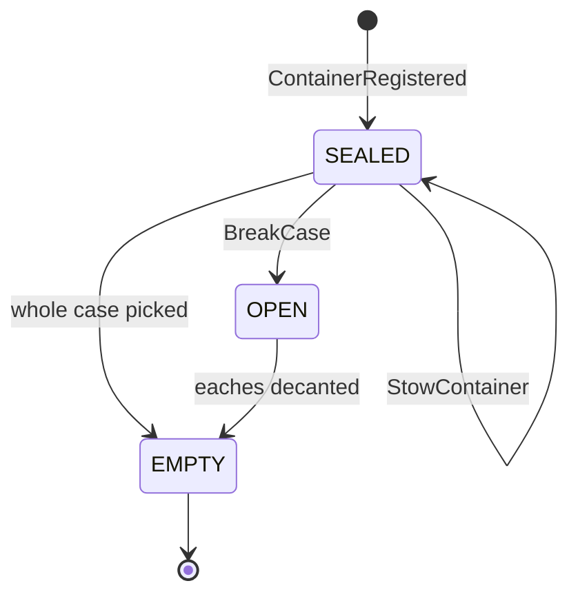

# 0045. Container (LPN), sealed cases and BreakCase; owner-segregated stock

## Status

**Proposed** (2026-10-23). Phase 0 of the mastercase / GTIN programme: this is a
design record, **nothing is built**. The authoritative cross-service contract is
`.hermes/plans/mastercase-briefs/contracts.md` in the `warehouse-systems`
workspace (sections 0, 2 and 3); the plan is
`.hermes/plans/2026-10-23_225746-mastercase-gtin-handling.md`. Every name below
is taken from that contract and must not drift.

Extends [ADR 0037](./0037-stock-receipts-from-inbound-receiving.md) (the
staged-receipt seam gains an optional second input and a small booking record;
the rule that `ReceiptLineReceived` is the quantity authority is kept) and
[ADR 0003](./0003-revocable-reservations.md) (reservations gain an owner
dimension). Builds on [ADR 0013](./0013-location-classification-via-facility-events.md)
(event-fed local copy of facility-layout data),
[ADR 0017](./0017-transactional-outbox.md),
[ADR 0019](./0019-optimistic-concurrency-version-column.md),
[ADR 0024](./0024-cloudevents-mandatory-envelope.md) and
[ADR 0040](./0040-bin-stock-level-changed-cloudevents.md). Does not change
[ADR 0042](./0042-postgres-and-kafka-are-the-only-runtime.md): the new consumer
logic runs inside the existing always-on inbound-receiving consumer.

## Context

Today a unit of stock is a `StockUnit` (`internal/domain/stock/stock_unit.go`):
`sku`, `binID`, `quantity`, `reserved`, `state` (AVAILABLE, RESERVED, PICKED,
REMOVED, UNLOCATED) and the custody fact `siteID`, with an optimistic `version`
(ADR 0019). Its constructor `NewStockUnit` rejects an empty `sku` or `binID`
(`ErrStowRequiresItemAndLocation`): stow is **item scan + location scan**,
nothing else. A `Bin` (`internal/domain/location/bin.go`) is a coded slot with a
`capacity` and `occupied` count in eaches, a `siteID`, and no notion of what
kind of handling unit it accepts. There is no container, no license plate and no
sealed-case state: a case of 12 and 12 loose units are the same thing to the
ledger, and the moment a case is received its identity is gone.

Three pressures make that a decision rather than a default.

1. **Cases arrive as identified physical objects.** The programme makes the ASN
   hierarchical (cartons identified by SSCC, contract section 2).
   inbound-receiving will publish a new `ReceiptCartonReceived` that carries
   carton identity. Warehouses store, replenish and pick whole cases without
   opening them; opening a case is a distinct physical act that must be
   recorded, and it must not create or destroy a single unit.
2. **Two events describe one receipt.** `ReceiptLineReceived` is already the
   booking source (ADR 0037) and stays the **sole quantity authority**, in
   eaches. `ReceiptCartonReceived` is identity only. If both booked quantity,
   every case would be counted twice; if only one existed, either identity or
   the ADR 0037 contract would be lost. The two arrive on one topic in no
   guaranteed relative order.
3. **Stock has an owner.** On the retail network a seller owns the goods; two
   sellers can legitimately sell the same each-GTIN. Decision O2 (resolved by
   the user, 2026-10-23) is that stock, listings and reservations are
   **segregated by `ownerRef`**; commingling is a later per-item opt-in and is
   not designed here. On the fleet `ownerRef` is an opaque tenant tag from the
   Vendor API (contract G4); absent means fleet-owned, which is all current
   data.

Fixed by the contract and not reopened here: eaches are the ledger unit (G1),
GTINs are 14-digit strings (G2), SSCCs are 18-digit mod-10 strings unique per
site (G3), lot and expiry are carried but FEFO is out of scope (G5), only the
EACH and CASE pack levels are implemented in v1 (G6).

## Decision

### 1. `Container` is a new aggregate; `StockUnit` stays in eaches

`Container` (entity `container`, subject = `lpn`) fields:
`lpn`, `sku`, `gtin` (the case GTIN), `unitsPerPack`, `qtyEaches`, `ownerRef?`,
`siteId`, `binId?`, `state` (`SEALED | OPEN | EMPTY`), `lot?`, `expiry?`,
`stockUnitId`, `version` (ADR 0019).

- The **LPN** is the carton's SSCC. For an `UnlabelledCarton` inbound-receiving
  mints an internal `LPN-<siteId>-<ulid>` and sends it as `lpn` in the event;
  this service never generates an LPN, and a container's LPN is unique per site.
- A `StockUnit` is **not** replaced. It stays `(sku, bin, quantity in eaches,
  reserved, state, siteID)` and gains two optional attributes: `ownerRef` and
  `packState` (`LOOSE | SEALED_CASE`). Absent `packState` reads as `LOOSE`, so
  every existing row and every existing caller keeps its meaning.
- A container and its stock are linked 1:1 while the case is stowed:
  `Container.stockUnitId` names a `SEALED_CASE` `StockUnit` whose `quantity`
  equals `qtyEaches`. Bin occupancy, usable quantity, cycle counts, relocation
  and `BinStockLevelChanged` therefore keep counting eaches with no change of
  unit. The container adds identity and a pack state on top of the ledger; it
  is not a second ledger.
- Invariants on the aggregate:
  - a `SEALED` container holds exactly one `gtin` and
    `qtyEaches == unitsPerPack * cases` (`ErrContainerQuantityMismatch`); a v1
    container is one physical case, so `cases` is 1, and the form is kept so a
    pallet-level container can follow without a new invariant;
  - the container's `siteId` must equal the bin's custody site on stow
    (`ErrContainerNotAtSite`);
  - a container is **never** created for a mixed carton (more than one SKU), a
    carton the receipt reported `sealed = false` (it was opened and counted into
    eaches), or a `Damaged` content (ADR 0037 does not book damaged lines in
    v1, so there is no quantity to identify). Those eaches remain ordinary
    staged stock.

`StowContainer` leaves the state `SEALED` and sets `binId` (event
`ContainerStowed`). `BreakCase` and a whole-case pick both end in `EMPTY` and
raise `ContainerEmptied`; see section 3 for why `OPEN` is short-lived in v1.

### 2. Commands

- **`StowContainer{lpn, bin}`** (scan the LPN, scan the location; the container
  analogue of item scan + location scan). It requires: the container exists and
  is `SEALED`; the bin exists, is located and is at the container's site; and
  the bin's `handlingUnit` accepts a sealed case (`CASE` or `PALLET`, never
  `EACH`). It consumes the staged quantity of `(sku, ownerRef)` equal to
  `qtyEaches`, creates the `SEALED_CASE` `StockUnit` in that bin (making the
  quantity usable, exactly as a plain stow does) and records `binId` and
  `stockUnitId` on the container. The bin's capacity check is unchanged and is
  in eaches. Re-stowing a stowed container to a different bin is a relocation of
  its unit (ADR 0039) and keeps the same checks.
- **`BreakCase{lpn, looseBin}`** (section 3).
- **`ReserveFullCases{sku, cases, ownerRef?}`** reserves `cases` whole `SEALED`,
  stowed containers of `sku` for `ownerRef` (absent = fleet-owned). It is a
  revocable reservation (ADR 0003): the allocation binds the container's
  `SEALED_CASE` `StockUnit` in full, records the pick location (`binId`, ADR
  0025) and quantity `cases * unitsPerPack` in eaches. It never allocates a
  partial case and never allocates from `LOOSE` stock. Confirming the pick of a
  full-case allocation removes the unit and moves the container to `EMPTY`
  (`ContainerEmptied`).

### 3. `BreakCase` conserves quantity

`BreakCase{lpn, looseBin}` is the only way a sealed case becomes loose eaches,
and it is explicit (an RF/task action, never inferred from a pick).

- Only a `SEALED` container can be broken (`ErrContainerNotSealed`). The
  container must be stowed, at the bin's site, and its `SEALED_CASE` unit must
  carry no reservation; breaking a case that is reserved is rejected, because
  the reservation names the case, not its eaches (`ErrContainerReserved`,
  proposed addition to the contract).
- `looseBin` must be a located bin at the same site that accepts loose eaches
  (`handlingUnit` `EACH`, or none recorded; a case-only bin is refused with
  `ErrBinHandlingUnitMismatch`, proposed addition to the contract).
- **Conservation.** In ONE `UnitOfWork` (ADR 0017) the `SEALED_CASE` unit is
  decremented by `qtyEaches`, a `LOOSE` unit of the same `(sku, ownerRef)` in
  `looseBin` is incremented by the produced eaches, and the transaction is
  rejected unless `produced == qtyEaches` (`ErrBreakNotConserving`). The loose
  units inherit `ownerRef`, `lot` and `expiry`. The ledger total in eaches is
  identical before and after.
- The transaction enqueues, through the outbox, `CaseBroken` and the two
  `BinStockLevelChanged` events (`fromBin`, `looseBin`), plus `ContainerEmptied`.
- **`OPEN` in v1.** A break moves the whole case, so the container reaches
  `EMPTY` in the same transaction that it leaves `SEALED`. `OPEN` is modelled
  now (and `CaseBroken` is the `SEALED -> OPEN` fact) so that breaking a case in
  place and picking part of it can be added later without a new state or a new
  event; v1 never persists `OPEN` across transactions. This differs from the
  plan's end-to-end wording "SEALED -> 1 OPEN": the observable v1 result of a
  break is an `EMPTY` container plus loose eaches. See Open questions.

### 4. Bin compatibility comes from facility-layout as event-fed local data

The bin's `handlingUnit` (`EACH | CASE | PALLET`) is a facility-layout
attribute (plan: facility-layout, bin attributes). This service does not call
facility-layout. Following ADR 0013 it keeps a local read model fed from
`warehouse.facility.events`; the stow path reads only that copy. A bin with **no
recorded `handlingUnit`** (every bin registered today, before facility-layout
ships the attribute) is treated as accepting `EACH` only for loose stock and is
**not** case-compatible: `StowContainer` into it fails closed with
`ErrBinHandlingUnitMismatch`. Existing `POST /stock/stow` of loose eaches is
unaffected by the attribute.

### 5. Owner segregation: reservations never span owners

- `ownerRef` is an opaque string (max 64, `[A-Za-z0-9._-]`; contract G4). This
  service never interprets it.
- `StockUnit` and `Container` carry it. Units are distinct per
  `(sku, bin, ownerRef)`: two owners' eaches of the same SKU in one bin are two
  rows, so segregation is a ledger property, not a physical one (bins are not
  owner-dedicated and the chaotic-storage rule of ADR 0002 still holds).
- **Reservation and availability queries filter by `ownerRef`.** An absent
  `ownerRef` on a request means fleet-owned stock **only**, never "any owner";
  a legacy caller therefore cannot accidentally allocate a seller's stock. A
  reservation is bound to exactly one owner and every allocation under it must
  carry that owner (`ErrOwnerMismatch` otherwise). This holds for `ReserveStock`,
  `ReserveFullCases` and `GET /inventory/{sku}/usable`, which gains an optional
  `ownerRef` query parameter.
- `BinStockLevelChanged` (ADR 0040) gains an optional `ownerRef`. When it is
  present the absolute level is that owner's level in the `(bin, sku)`; when it
  is absent the event is byte-identical to today's and means fleet-owned stock.
  pick-face-replenishment's existing consumer sees no change for fleet stock.
- Commingling by GTIN is explicitly out of scope; adding it later is a new
  decision that relaxes the filter per item, not a migration of this one.

### 6. Containers come from `ReceiptCartonReceived`; quantity comes only from `ReceiptLineReceived`

This is the double-count rule (contract section 2), made concrete.

- `ReceiptLineReceived` (ADR 0037) still books staged quantity in eaches, Good
  lines only, through `ReceiveStock`. Its new optional `ownerRef`, `packGtin`,
  `cases` and `sscc` are read: `ownerRef` segregates the staged quantity; the
  others are logged for provenance and are **never** added to the booked
  quantity. Alongside the booking this service now records, per
  `(receiptId, lineNo)`, the booked eaches (a `receipt_line_bookings` row).
  This is the one place ADR 0037's "receipt context is not stored" is narrowed:
  the minimum needed to bound containers.
- `ReceiptCartonReceived` **never** books quantity. For each Good, single-SKU,
  sealed carton it creates a `Container` keyed `(receiptId, lineNo, sscc)`:
  state `SEALED`, `lpn` from the event, `gtin` and `unitsPerPack` resolved from
  the local packaging copy, `qtyEaches` from the carton content, no bin yet.
- **Either arrival order works.** A carton whose line has not been booked yet,
  or whose registration would push `sum(container qtyEaches)` for
  `(receiptId, lineNo)` above the booked quantity, is held in a
  `container_pending_links` table keyed `(receiptId, lineNo, sscc)` and
  re-evaluated when the booking arrives. The rule is
  `sum(container qty) per (receiptId, lineNo) <= booked qty`; a container can
  therefore never exist for units the ledger has not counted.
- **Idempotency.** The carton event id is claimed in `processed_events` under a
  new consumer name, `inbound-carton`, in the same `UnitOfWork` as the effect
  (the ADR 0037 pattern); the `(receiptId, lineNo, sscc)` key and the unique
  LPN-per-site constraint make a redelivery under a different event id also a
  no-op. A duplicate SSCC at a different receipt is a conflict, logged at WARN
  and left to inbound-receiving's `DuplicateSscc` discrepancy; it is never
  merged.
- Failure policy is unchanged from ADR 0037: malformed events are skipped with a
  WARN and committed past. A carton that stays pending is visible in a metric
  and never blocks the booking path.

### 7. Event payloads

All four are CloudEvents 1.0 structured JSON (ADR 0024) with type
`com.warehouse.wms.inventory-storage.container.<Event>`, published through the
outbox on the existing integration topic (`warehouse.inventory.events`),
`subject` and Kafka key = `lpn` (ADR 0021), `dataschema`
`urn:warehouse:inventory-storage:events:<Event>:v1`. All new fields on existing
events are optional and additive; v1 stays v1.

| Event | `data` |
| --- | --- |
| `ContainerRegistered` | `lpn`, `sku`, `gtin`, `unitsPerPack`, `qtyEaches`, `ownerRef?`, `siteId`, `lot?`, `expiry?`, `receiptId`, `lineNo`, `at` |
| `ContainerStowed` | `lpn`, `sku`, `qtyEaches`, `ownerRef?`, `siteId`, `bin`, `at` |
| `CaseBroken` | `lpn`, `sku`, `qtyEaches`, `fromBin`, `looseBin`, `at` (plus `ownerRef?`) |
| `ContainerEmptied` | `lpn`, `sku`, `ownerRef?`, `siteId`, `reason` (`BROKEN` or `PICKED`), `at` |

`CaseBroken` is exactly `{lpn, sku, qtyEaches, fromBin, looseBin, at}` from the
contract; `ownerRef` is the additive optional field. Field casing on the wire
(the contract names are camelCase; existing inventory-storage payloads are
snake_case, for example `from_bin`) is settled when `apis/asyncapi.yaml` is
written, not here. Existing `stock.StockReceived` keeps eaches and is unchanged.

### 8. REST

- `POST /containers/{lpn}:stow` — body `bin`; `StowContainer`.
- `POST /containers/{lpn}:break` — body `looseBin`; `BreakCase`.
- `GET /containers/{lpn}` — the container and its state.
- `GET /bins/{bin}/containers` — containers stowed in a bin.

Errors are RFC 7807 Problem Details (ADR 0005); writes honour
`Idempotency-Key` (ADR 0018). `ReserveFullCases` is a use case reached from the
existing reservation seam and from fulfillment-execution's events, not a new
public write endpoint in v1. The `{lpn}` and `{bin}` placeholders are path
parameters, written here in code spans.

### 9. Rollout

Additive and dormant: a database migration adds nullable `owner_ref` and
`pack_state` to stock, the `container`, `receipt_line_bookings` and
`container_pending_links` tables, and the bin `handling_unit` copy. With no
cartons on the wire and no `ownerRef` anywhere, behaviour is identical to today.

## Consequences

- **Easier:** a case keeps its identity from dock to door; full-case picks and
  case replenishment are expressible; breaking a case is audited and cannot
  create or lose a unit; sellers' stock cannot be sold to another seller's order.
- **Easier:** eaches stay the one ledger unit, so cycle counts, relocation,
  `BinStockLevelChanged`, the usable-quantity API and the analytics products need
  no unit conversion.
- **Harder:** two aggregates now describe one physical thing. The 1:1
  `Container`/`StockUnit` link is a consistency obligation, held by writing both
  in one `UnitOfWork`, and a cycle-count shortfall on a `SEALED_CASE` unit must
  also move its container (to `EMPTY`, flagged as a discrepancy); the exact rule
  belongs to the implementation phase.
- **Harder:** ADR 0037's "receipt context is not stored" no longer holds in full:
  `(receiptId, lineNo, booked eaches)` is persisted, and a pending-link table
  must be monitored and swept.
- **Harder:** every availability and reservation query gains an owner predicate,
  and fleet-owned stock needs an explicit "no owner" match in indexes. Every
  caller that omits `ownerRef` sees only fleet stock, which is the safe default
  and a behaviour change for any seller stock that is booked by mistake without
  one.
- **Dependency:** case stow is blocked on facility-layout publishing
  `handlingUnit`; until then no case can be stowed, only registered. That is the
  intended fail-closed behaviour.
- **Dependency:** unitsPerPack and the case GTIN come from a local copy of
  product-master's pack levels (the plan's `PackagingView`), which does not
  exist yet. A carton whose GTIN is unknown locally stays pending, never guessed.
- A broken case produces fungible loose stock: provenance back to the LPN lives
  in `CaseBroken`, not on the loose units.

## Alternatives considered

1. **Container as a `StockUnit` state only** (add `SEALED` to `State`, put the
   LPN on the unit). Rejected: a `StockUnit` is `(sku, bin)`-shaped and can be
   merged, split and partially reserved, while a container is a single physical
   object with its own identity, history and events. It would also overload the
   `State` machine of ADR 0003 (AVAILABLE, RESERVED, PICKED...) with an
   orthogonal pack dimension, and make `BreakCase` a state flip instead of an
   audited conservation transfer.
2. **Book quantity from `ReceiptCartonReceived`** (one event, carton-first).
   Rejected: it makes the carton event a second quantity authority beside
   `ReceiptLineReceived`, which ADR 0037 and the contract fix as the sole one;
   it double-counts as soon as both arrive, breaks flat (cartonless) ASNs, and
   couples every existing consumer to the hierarchical ASN.
3. **Convert cases to eaches at receipt and lose identity** (status quo plus a
   multiplier). Rejected: it cannot support full-case picking or replenishment,
   cannot reconcile a short or mixed carton against the SSCC the seller was
   told about, and gives a break nothing to conserve. It remains the behaviour
   for unlabelled, opened, mixed and damaged cartons by design.
4. **Commingle by GTIN and tag ownership at settlement time.** Rejected by
   decision O2: two sellers can share an each-GTIN, and a reservation must not
   cross sellers. It stays a later opt-in.
5. **Call facility-layout for bin compatibility at stow.** Rejected for the
   reasons of ADR 0013: it makes the reference-data service a runtime
   dependency of stowing.

## Open questions

- Whether the plan's end-to-end step "SEALED -> 1 OPEN" should read "SEALED -> 1
  EMPTY (broken)" given section 3, or whether v1 should persist `OPEN` until a
  disposal confirmation.
- `ErrContainerReserved` and `ErrBinHandlingUnitMismatch` are named here but are
  not in contract section 3; they need to be added to the contract before
  `model.yaml` is written.
- Wire casing of the new payloads (see section 7).
