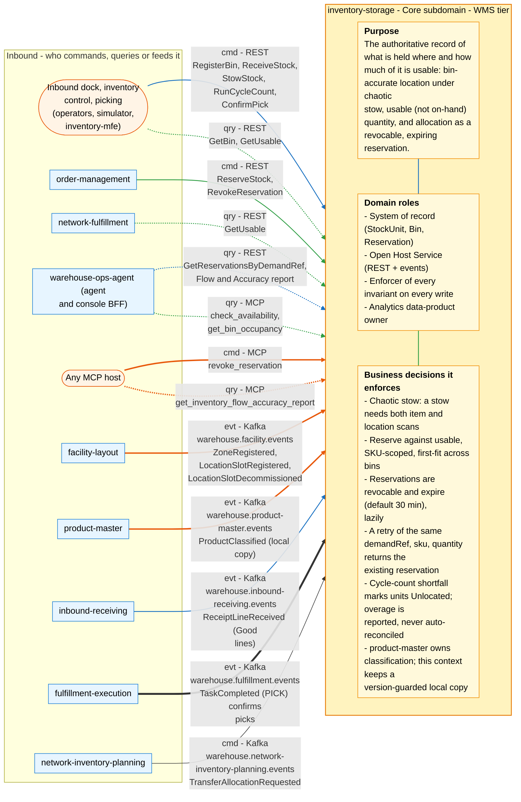
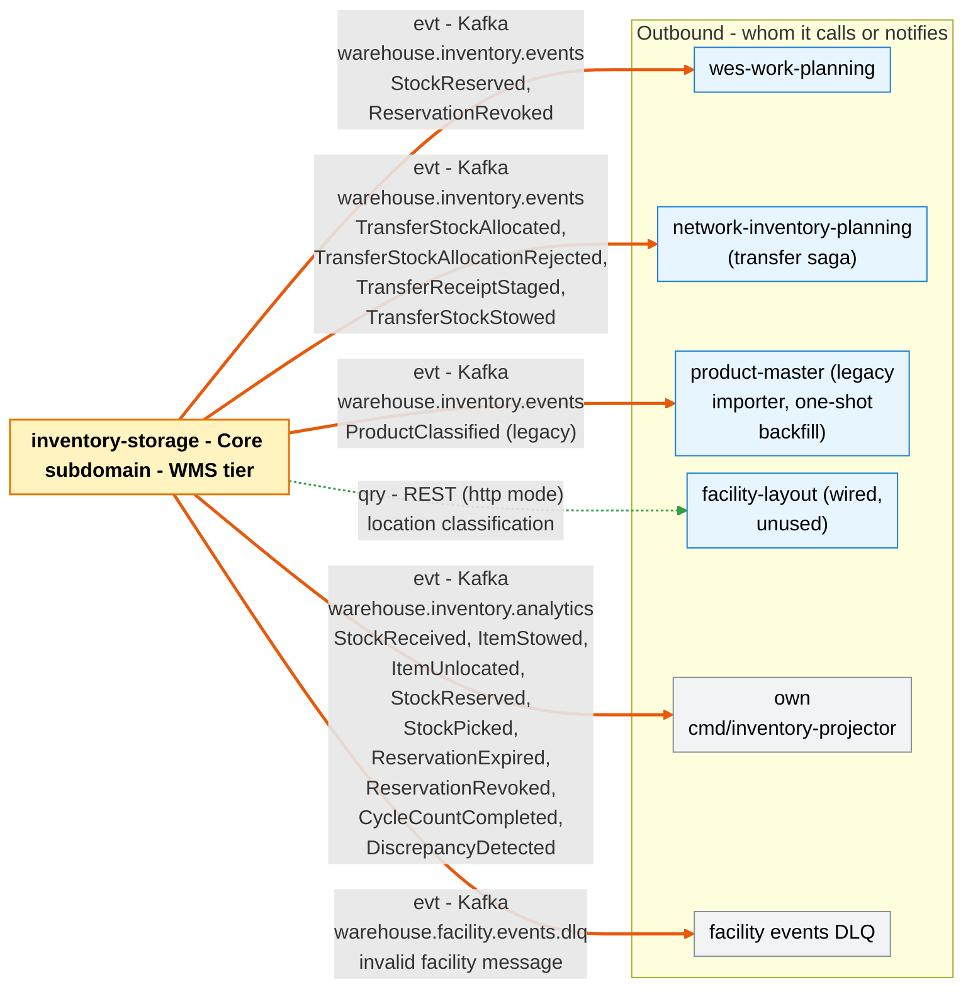

# Bounded Context Canvas

Following the [ddd-crew Bounded Context Canvas](https://github.com/ddd-crew/bounded-context-canvas)
(v5). Every message row maps to a real REST route, MCP tool or Kafka topic
and CloudEvents `type` in the code on `develop`; the relationship column uses
the [Context Map](/docs/ecosystem/context-map) vocabulary.

## Canvas at a glance

Two pictures of the sections below, laid out like the ddd-crew canvas:
first the inbound collaborators feeding this context (purpose, domain roles
and the business decisions it enforces), then the outbound collaborators it
calls or notifies. Arrows follow the message type: **solid blue**
commands (`cmd`), **dotted green** queries (`qry`), **thick orange** events
(`evt`); each arrow names its channel and the messages it carries. Box shapes
mark the collaborator kind: rounded = people, UI or any client; blue =
sibling bounded context; double border = external system or platform;
grey = this context's own projector, reports or dead-letter path; dashed =
published today with no consumer. Channel names on the arrows are
abbreviated (REST, MCP, Kafka, HTTP, port); the Inbound and Outbound
Communication tables carry the exact route, tool, topic and CloudEvents
type for every message.

### Inbound

### Outbound

Source: the Inbound Communication and Outbound Communication tables of this
page, which map to `internal/adapters/inbound/{http,kafka,mcp}` and `internal/adapters/outbound/`. The diagram omits assumptions, verification metrics, open
questions and the ubiquitous language (sections below), the relationship
pattern per message (OHS, ACL, Conformist, Customer/Supplier - see the
tables) and anything the tables mark as deprecated or platform-only
(health probes).

## Name

**Inventory & Storage** — repository `inventory-storage`, CloudEvents
subdomain `wms`, `source=/warehouse/inventory-storage`.

## Purpose

The WMS-tier authoritative record of **what is held where, and what portion
of it is usable**. It answers the two questions everything downstream depends
on: *where* a SKU physically is (bin-accurate, under chaotic stow with
mandatory item + location scan) and *how much* of it can be promised
(usable, not on-hand). Allocation is a revocable, expiring reservation, so a
failed physical delivery never strands an order. It does **not** own SKU
handling classification (hazmat, temperature, DOT class): product-master does,
and this context keeps a version-guarded local copy of it for its own stow
placement and DOT segregation rules ([ADR 0034](/docs/adr/0034)).

## Strategic Classification

| Dimension | Classification | Justification |
| --- | --- | --- |
| **Domain** | **Core** | Matches [Subdomain Classification](./subdomain-classification.md) and the [Core Domain Chart](./core-domain-chart.md): "Inventory & Slotting" is Core in the reference model; four aggregates and 30 tested invariants. |
| **Business Model** | **Revenue enabler** | Sells nothing directly, but every customer promise ("6 units will ship") rests on the usable answer; over-promising or stranding orders costs revenue and SLA credibility. |
| **Evolution** | **Custom-built, moving towards Product** | Hand-built, heavily tested and still gaining capabilities (ADRs 0017-0026); its REST and event contracts are already versioned Published Language that several contexts consume unchanged. |

## Domain Roles

| Role | Stance |
| --- | --- |
| **System of record** | For `StockUnit`, `Bin` and `Reservation`. No other context has write access to any of them. `ProductClassification` here is a local copy of product-master's classification, written only by the `warehouse.product-master.events` consumer ([ADR 0034](/docs/adr/0034)). |
| **Open Host Service** | For bin-accurate location and usable inventory, with a Published Language on two surfaces: REST (`apis/openapi.yaml`) and events (`apis/asyncapi.yaml`). The classification read `GET /products/{sku}/classification` is deprecated. |
| **Enforcer** | Runs every invariant on every write — capacity, usable, no double-consume, placement, DOT segregation — whoever the caller is. |
| **Analytics data-product owner** | Owns its own analytical data product (Flow & Accuracy report, ADR 0011), fed only by its own events. |

## Inbound Communication

| Collaborator | Message | Type | Channel | Relationship |
| --- | --- | --- | --- | --- |
| `order-management` | ReserveStock | Command | REST `POST /reservations` (header `Idempotency-Key`) | C/S, caller-side ACL |
| `order-management` | RevokeReservation | Command | REST `DELETE /reservations/{id}` | C/S, caller-side ACL |
| none in the fleet (deprecated) | GetProductClassification | Query | REST `GET /products/{sku}/classification`, served from the local copy until product-master ADR 0003 stage E; `order-management`, `wes-work-planning` and `fulfillment-execution` now keep their own copies from product-master | OHS/PL |
| `network-fulfillment` | GetUsable | Query | REST `GET /inventory/{sku}/usable` | OHS/PL, caller-side ACL |
| `warehouse-ops-agent` (console BFF) | GetReservationsByDemandRef | Query | REST `GET /reservations?demandRef=` | OHS/PL, Conformist |
| `warehouse-ops-agent` | Flow & Accuracy report | Query | REST `GET /reports/flow-accuracy`, `GET /reports/flow-accuracy/freshness` (`cmd/inventory-reports`) | OHS/PL, Conformist |
| `warehouse-ops-agent` (agent) | check availability | Query | MCP tool `check_availability` (`cmd/mcp`, Streamable HTTP) | OHS |
| `warehouse-ops-agent` (agent) | bin occupancy | Query | MCP tool `get_bin_occupancy` | OHS |
| Any MCP host | revoke reservation | Command | MCP tool `revoke_reservation` (annotated destructive) | OHS — no sibling calls it today |
| Any MCP host | Flow & Accuracy report | Query | MCP tool `get_inventory_flow_accuracy_report` (only when `REPORTS_BASE_URL` is set); resource `inventory://{sku}/usable`; prompt `triage_low_stock` | OHS |
| `facility-layout` | ZoneRegistered | Event | Kafka `warehouse.facility.events`, `com.warehouse.wms.facility-layout.zone.ZoneRegistered` | Conformist |
| `facility-layout` | LocationSlotRegistered | Event | Kafka `warehouse.facility.events`, `com.warehouse.wms.facility-layout.locationslot.LocationSlotRegistered` | Conformist |
| `facility-layout` | LocationSlotDecommissioned | Event | Kafka `warehouse.facility.events`, `com.warehouse.wms.facility-layout.locationslot.LocationSlotDecommissioned` | Conformist |
| Inventory control (operator, `e2e-tests` simulator) | RegisterBin | Command | REST `PUT /bins/{binId}` | OHS |
| Inbound dock (operator, simulator) | ReceiveStock | Command | REST `POST /stock/receive` (header `Idempotency-Key`) | OHS |
| inbound-receiving | ReceiptLineReceived (`Good` lines, ADR 0037) | Event | Kafka `warehouse.inbound-receiving.events` → `BookInboundReceiptLine` → `ReceiveStock` (`INBOUND_RECEIPT_CONSUMER_GROUP`, default off); `Damaged` lines are not booked | Conformist (inbound-receiving's Published Language); the REST route above is unchanged |
| Inbound dock (operator, simulator) | StowStock | Command | REST `POST /stock/stow` | OHS |
| Inventory control (operator, simulator) | RunCycleCount | Command | REST `POST /bins/{binId}/cycle-count` | OHS |
| product-master | ProductClassified (local copy, ADR 0034) | Event | Kafka `warehouse.product-master.events` → `ApplyProductClassification` | Conformist (product-master's Published Language); `PUT /products/{sku}/classification` answers 410 |
| Picking (operator, simulator) | ConfirmPick | Command | REST `POST /reservations/{id}/confirm-pick` | OHS — no sibling context calls it; **decided 2026-10-06: event-driven** — production confirmation comes from fulfillment-execution's `TaskCompleted` (next row), consumed here ([ADR 0035](/docs/adr/0035)) |
| fulfillment-execution | TaskCompleted (PICK, `order_ref`, `line_no`) | Event | Kafka `warehouse.fulfillment.events`, `com.warehouse.wes.fulfillment-execution.task.TaskCompleted` → `ConfirmPicksForOrder` → with `line_no`, `ConfirmPick` for exactly that line's ACTIVE reservation; without it, counts the order's picks and confirms on the order's last pick (`TASK_COMPLETED_CONSUMER_MODE=kafka`, default off) | Conformist (fulfillment-execution's Published Language); per-line confirm, counting fallback, short picks not modelled ([ADR 0036](/docs/adr/0036), [ADR 0035](/docs/adr/0035)) |
| Operator, `inventory-mfe` | GetBin, GetUsable | Query | REST `GET /bins/{binId}`, `GET /inventory/{sku}/usable` | OHS |
| Kubernetes | liveness / readiness | Query | REST `GET /healthz`, `GET /readyz` | — |
| network-inventory-planning | TransferAllocationRequested | Command | Kafka `warehouse.network-inventory-planning.events`, `com.warehouse.wes.network-inventory-planning.transfer.TransferAllocationRequested` → `transfer_consumer.go` (`TRANSFER_ALLOCATION_CONSUMER_MODE=kafka`, default off; [ADR 0030](/docs/adr/0030)) | Conformist to NIP's Published Language; reply by event |

## Outbound Communication

| Collaborator | Message | Type | Channel | Relationship |
| --- | --- | --- | --- | --- |
| `wes-work-planning` | StockReserved | Event | Kafka `warehouse.inventory.events`, `com.warehouse.wms.inventory-storage.reservation.StockReserved` (key = reservation id) | OHS/PL; downstream Conformist |
| `wes-work-planning` | ReservationRevoked | Event | Kafka `warehouse.inventory.events`, `com.warehouse.wms.inventory-storage.reservation.ReservationRevoked` (key = reservation id) | OHS/PL; downstream Conformist |
| `network-inventory-planning` (transfer saga) | TransferStockAllocated, TransferStockAllocationRejected, TransferReceiptStaged, TransferStockStowed | Event | Kafka `warehouse.inventory.events`, `com.warehouse.wms.inventory-storage.reservation.TransferStockAllocated` / `...reservation.TransferStockAllocationRejected` / `...stock.TransferReceiptStaged` / `...stock.TransferStockStowed` ([ADR 0030](/docs/adr/0030), [ADR 0033](/docs/adr/0033)) | OHS/PL; downstream Conformist |
| product-master (legacy importer) | ProductClassified (legacy) | Event | Kafka `warehouse.inventory.events`, `com.warehouse.wms.inventory-storage.product.ProductClassified` (key = SKU; full-state replacement), emitted **only** by the one-shot `republish-product-classifications` backfill ([ADR 0034](/docs/adr/0034); run once, 2026-10-07) | PL; product-master translates it in its importer (ACL) |
| own projector (`cmd/inventory-projector`) | StockReceived, ItemStowed, ItemUnlocated, StockReserved, StockPicked, ReservationExpired, ReservationRevoked, CycleCountCompleted, DiscrepancyDetected | Event | Kafka `warehouse.inventory.analytics`, `com.warehouse.wms.inventory-storage.<stock, reservation or bin>.<EventName>` (nothing emits `ProductClassified` there since ADR 0034) | internal |
| `facility-layout` | location classification | Query | REST `GET /locations/{locationCode}/classification` — only with `LOCATION_LOOKUP_MODE=http`, behind a circuit breaker | ACL; wired but unused (rollback) |
| `facility-layout` (DLQ) | invalid facility message | Event | Kafka `warehouse.facility.events.dlq` (raw payload + `x-dlq-*` headers) | — |

All Kafka messages are CloudEvents 1.0 structured mode. With Postgres and
`EVENT_PUBLISHER=kafka` they leave through the transactional outbox and the
relay in `cmd/inventory` (ADR 0017).

## Ubiquitous Language

Full glossary: [Ubiquitous Language](/docs/business-context/ubiquitous-language).
The terms that carry the model:

| Term | Meaning |
| --- | --- |
| **StockUnit** | A quantity of a SKU at one bin — every item has one known bin or is Unlocated. |
| **Bin** | A coded slot with a capacity; any SKU may use any free bin. |
| **Stow** | Item scan + location scan; the only way a StockUnit is created. |
| **Usable inventory** | On-hand minus reserved minus unlocated/removed — what constrains release. |
| **Reservation** | A revocable, expiring claim against usable, with allocations and pick locations. |
| **Revoke / Expire / Confirm pick** | The three ways a reservation is resolved. |
| **Cycle count** | Verifying a bin; shortfall marks units Unlocated, overage is reported. |
| **ProductClassification** | SKU handling master data: handling tags, temperature class, DOT hazard class — a local copy of product-master's, not authored here. |
| **Demand reference** | The caller's opaque order+line key; replay-guard and lookup key. |

## Business Decisions

| Decision | Source |
| --- | --- |
| Chaotic (random) stow, no fixed slotting; a stow needs both scans. | ADR 0002, `stock.ErrStowRequiresItemAndLocation` |
| Reserve against **usable**, SKU-scoped and first-fit across bins; never bin-scoped. | ADR 0003, `ReserveStock.allocate` |
| Reservations are revocable and expire after a timeout (default 30 min); expiry is lazy, on the next read. | ADR 0003, `DefaultReservationTimeout`, `expireIfDue` |
| A retry for the same `(demandRef, sku, quantity)` returns the existing ACTIVE reservation. | `isReplayOf` |
| Cycle-count shortfall marks whole units Unlocated; overage is reported, never auto-reconciled. | `RunCycleCount` |
| product-master owns product classification; this context keeps a version-guarded local copy and answers `410` to `PUT /products/{sku}/classification`. Placement rules are fail-open for unclassified SKUs and unknown bins, fail-closed only when a classified SKU's lookup fails. | ADR 0009, [ADR 0034](/docs/adr/0034) |
| DOT segregation uses a 9 × 9 class-level matrix with four documented simplifications. | ADR 0010, `product.Incompatible` |
| Bins are registered declaratively over REST; registration raises no event. | ADR 0025 |
| `StockReserved` and `ReservationRevoked` are the integration events, plus the transfer replies (ADR 0030, ADR 0033); the legacy `ProductClassified` (ADR 0031) is emitted only by the one-shot backfill since ADR 0034. | `kafka.Publisher.Encode`, `apis/asyncapi.yaml` |
| Zone data comes from facility-layout's events into a local cache, not a per-stow call. | ADR 0013 |
| No authentication on REST or MCP. | ADR 0015 |

## Assumptions

- A `BinId` is directly usable as a facility-layout `LocationCode`
  (documented simplification in `ports.LocationClassificationLookup`).
- `demandRef` identifies one order line; the caller keeps it stable across
  retries (order-management derives its `Idempotency-Key` from order id and
  line number).
- Downstream consumers dedupe on the CloudEvents `id` and tolerate
  at-least-once, per-reservation-ordered delivery (ADR 0021).
- Reservation read traffic is high enough that lazy expiry reclaims stale
  holds in practice.
- facility-layout publishes every zone and slot change; an empty cache means
  every stow fails open.
- A `StockUnit` never changes bin, so `Allocation.BinID` stays valid.

## Verification Metrics

| Metric | Source |
| --- | --- |
| `inventory.reservations` counter by `outcome` (`created`, `revoked`) | `internal/adapters/outbound/telemetry/metrics.go` |
| `http.server.request.duration`, `http.server.active_requests` | `otelchimetric` middleware (ADR 0016) |
| `circuit_breaker.state` gauge per dependency | `telemetry/circuit_breaker_metrics.go` (ADR 0020) |
| Flow & Accuracy counters per SKU/bin/hour — `discrepanciesDetected`, `unlocatedCount`, `reservationsExpired` vs `reservationsCreated` | `GET /reports/flow-accuracy` |
| Projection freshness `lagSeconds` | `GET /reports/flow-accuracy/freshness` |
| Quality gates: 90% coverage on domain + application, blocking `mutation-fast`, `arch-test`, `bdd`, `contract` | `.github/workflows/ci.yml` |

## Open Questions

- ~~Should a background job reclaim reservations that time out and are never
  read again?~~ **Decided 2026-10-06: kept** — expiry stays lazy (ADR 0003);
  they hold quantity until read or revoked.
- ~~Should `ProductClassified` be published so siblings stop polling
  `GET /products/{sku}/classification`?~~ **Decided 2026-10-06: yes** —
  published through the outbox on both topics, additive ([ADR 0031](/docs/adr/0031)).
  `LocationRecorded` stays in-process (no consumer). **Superseded by
  [ADR 0034](/docs/adr/0034):** product-master now owns classification and
  siblings read product-master's `ProductClassified`; this service emits its
  legacy type only from the one-shot backfill.
- Should `StowStock` validate a bin against facility-layout's slot catalogue,
  not only against its own `LocationRepo`?
- ~~Who should call `POST /reservations/{id}/confirm-pick` in production?~~
  **Decided 2026-10-06: nobody** — this context consumes fulfillment-execution's
  `TaskCompleted` (PICK, additive `order_ref`) and confirms the reservations
  itself, idempotently and atomically; no sync REST/MCP call from siblings
  ([ADR 0035](/docs/adr/0035), supersedes ADR 0032). **Decided 2026-10-07 (audit
  decision 18): per line** — with the additive `line_no` on `TaskCompleted`, and
  the `line_no` that `Reservation` now stores (order-management sends `lineNo`),
  exactly the picked line's reservation is confirmed ([ADR 0036](/docs/adr/0036));
  the ADR 0035 counting (confirm on the order's **last** pick, never early) stays
  as the fallback for events or reservations without a line.
- Short picks: a Task carries no SKU or quantity, so a confirmed line's whole
  reserved quantity is picked. Modelling a short pick needs
  per-line quantities in work-planning's WorkUnit and fulfillment-execution's
  Task, and a rule for the remainder — explicit limitation of
  [ADR 0035](/docs/adr/0035), not yet decided.
- ~~Per-line confirmation (order-management sends `line_no`, `Reservation` stores it,
  `TaskCompleted` carries it)?~~ **Decided 2026-10-07: built** ([ADR 0036](/docs/adr/0036));
  the pick counter remains only as the backward-compatible fallback.
- ~~Should the default `LOCATION_LOOKUP_MODE` stay `permissive`?~~
  **Decided 2026-10-06: kept** (ADR 0013/0020) — a cold facility cache would
  reject every receipt; the cluster already injects `kafka`.
- Should the reservation replay guard become a database constraint, closing
  the concurrent first-attempt race?
- Placement rules for `Fragile`, `Oversized` and `HighValue` are unbuilt —
  in this context or in facility-layout's `PlacementRule`?
