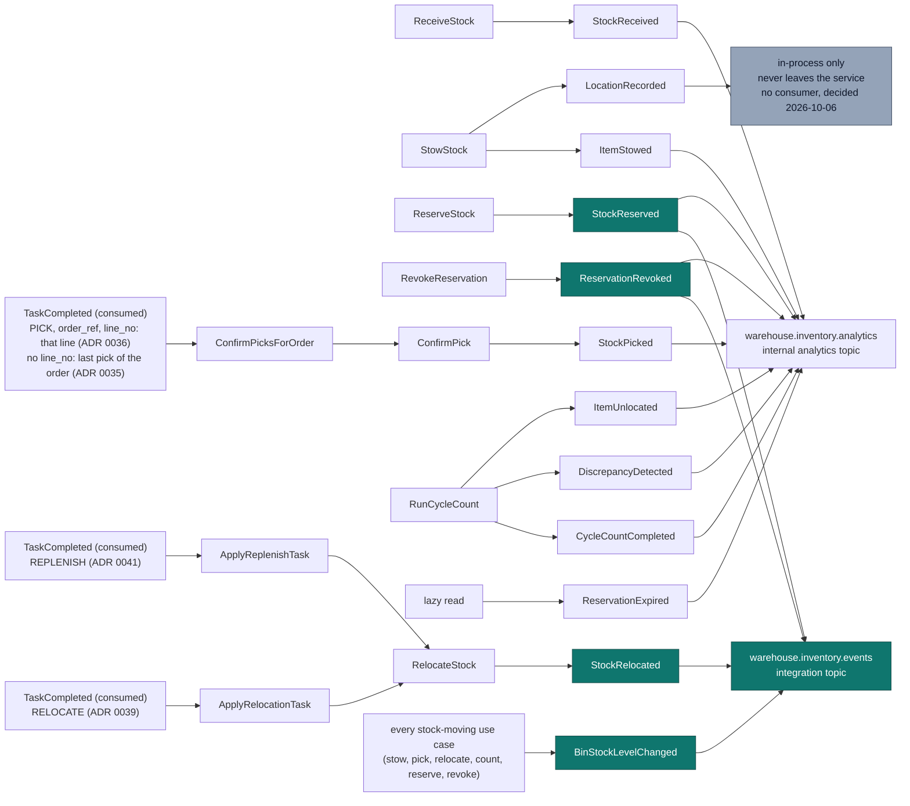

# Domain Events

Eleven past-tense events, raised by four aggregates. Every event carries an
`occurredAt` taken from the injected `Clock` port — never wall-clock time at
publish — so ordering is a domain fact rather than an infrastructure artefact.

```go
// internal/domain/shared/events.go
type DomainEvent interface {
	EventName() string
	OccurredAt() time.Time
}
```

The domain never depends on the publishing mechanism. Use cases hand events to
`ports.EventPublisher`; which adapter is behind it (log, buffered, Postgres
table, Kafka) is a composition-root decision.

## The catalog

| Event | Raised by | Raised when | Payload |
| --- | --- | --- | --- |
| `StockReceived` | StockUnit *(pre-location)* | `ReceiveStock` acknowledges inbound goods | `sku`, `quantity` |
| `ItemStowed` | StockUnit | `StowStock` succeeds — item-scan + location-scan both present | `sku`, `binId`, `quantity` |
| `LocationRecorded` | StockUnit | Immediately after `ItemStowed`; the bin now authoritatively holds this unit | `stockUnitId`, `binId` |
| `StockReserved` | Reservation | `ReserveStock` succeeds | `reservationId`, `sku`, `quantity`, `demandRef` |
| `ReservationExpired` | Reservation | A reservation's timeout elapses and is discovered at the next read (`GetReservationsByDemandRef`, `RevokeReservation`, `ConfirmPick`, or `ReserveStock`'s own idempotency lookup) — **lazy, not swept**, see below | `reservationId` |
| `ReservationRevoked` | Reservation | `RevokeReservation` succeeds | `reservationId` |
| `StockPicked` | Reservation | `ConfirmPick` consumes a reservation — from the REST route, or, in production, from `ConfirmPicksForOrder` on fulfillment-execution's `TaskCompleted`: for exactly the picked line when the event carries `line_no` ([ADR 0036](/docs/adr/0036)), on the order's last pick otherwise ([ADR 0035](/docs/adr/0035)) | `reservationId`, `sku`, `quantity` |
| `ItemUnlocated` | StockUnit | A cycle-count shortfall cannot account for stock | `stockUnitId`, `sku`, `binId`, `quantity` |
| `CycleCountCompleted` | Bin | Any cycle count finishes, clean or not | `binId`, `countedQty`, `systemQty`, `discrepancy` |
| `DiscrepancyDetected` | Bin | A cycle count finds counted ≠ system | `binId`, `countedQty`, `systemQty` |
| `StockRelocated` | Relocation | `RelocateStock` moves a quantity of one SKU between two bins of one site — from `POST /relocations` or, for a completed `RELOCATE` task, from `ApplyRelocationTask` ([ADR 0039](/docs/adr/0039)), and for a completed `REPLENISH` task (reason `REPLENISHMENT`, `sourceRef` = the replenishment request id), from `ApplyReplenishTask` ([ADR 0041](/docs/adr/0041)) | `relocationId`, `siteId`, `sku`, `fromBin`, `toBin`, `quantity`, `reason`, `sourceRef` |
| `BinStockLevelChanged` | StockUnit ledger *(per bin and SKU)* | Any use case that moves a (bin, SKU) level, from the same transaction: stow, pick, relocate (source then destination), cycle-count shortfall, reserve, revoke / expiry ([ADR 0040](/docs/adr/0040)) | `siteId`, `binId`, `sku`, `onHand`, `reserved` (absolute levels), `version` (per bin and SKU), `reason` |

## Which events flow where



**`StockReserved` and `ReservationRevoked` are the integration events on the
reservation path** (plus
the two transfer replies, [ADR 0030](/docs/adr/0030), `StockRelocated` on
the relocation path, [ADR 0039](/docs/adr/0039), and `BinStockLevelChanged`,
the per-bin absolute level feed, [ADR 0040](/docs/adr/0040)). The legacy
`ProductClassified` (ADR 0034, product-master ADR 0003) was removed at stage
E (2026-10-17), together with its republish command. The integration
publisher's `Encode` returns nothing for every other event — deliberate, not
an oversight: those are the published integration contract. Nine of the
thirteen events go to the internal analytics topic (`StockRelocated` and
`BinStockLevelChanged` do not: they are integration-only); `LocationRecorded` goes
nowhere (no outbox row, no Kafka message — it has no consumer, so it stays
in-process by decision). `apis/asyncapi.yaml` documents both channels, so a
downstream team cannot mistake a documented analytics event for a wired
integration one.

## Wire catalogue

Every published event, from the publishers' `Encode` methods
(`internal/adapters/outbound/kafka/publisher.go`,
`analytics_publisher.go`). All messages are CloudEvents 1.0 structured mode,
`source=/warehouse/inventory-storage`, routed with the `Hash` balancer on the
Kafka key (ADR 0021), and — always, since Postgres is the only runtime —
enqueued in `outbox_events` by the producing use case's transaction and
relayed by `cmd/inventory`.

| Event | Full CloudEvents `type` | Topic | Kafka key / `subject` | `data` fields | Producer use case | Known consumers |
| --- | --- | --- | --- | --- | --- | --- |
| StockReserved | `com.warehouse.wms.inventory-storage.reservation.StockReserved` | `warehouse.inventory.events` | reservation id / reservation id | `sku`, `quantity`, `demand_ref` | `ReserveStock` | `wes-work-planning` (decrements its observed usable) |
| StockReserved | same `type` | `warehouse.inventory.analytics` | reservation id / reservation id | `sku`, `reservation_id`, `quantity` | `ReserveStock` | `cmd/inventory-projector` |
| ReservationRevoked | `com.warehouse.wms.inventory-storage.reservation.ReservationRevoked` | `warehouse.inventory.events` | reservation id / reservation id | `sku`, `quantity`, `demand_ref` (enriched by repo lookup) | `RevokeReservation` (REST and MCP) | `wes-work-planning` (increments its observed usable) |
| ReservationRevoked | same `type` | `warehouse.inventory.analytics` | reservation id / reservation id | `reservation_id`, `sku` (enriched) | `RevokeReservation` | `cmd/inventory-projector` |
| ReservationExpired | `com.warehouse.wms.inventory-storage.reservation.ReservationExpired` | `warehouse.inventory.analytics` | reservation id / reservation id | `reservation_id`, `sku` (enriched) | lazy expiry in `GetReservationsByDemandRef`, `ReserveStock`, `RevokeReservation`, `ConfirmPick` | `cmd/inventory-projector` |
| StockPicked | `com.warehouse.wms.inventory-storage.reservation.StockPicked` | `warehouse.inventory.analytics` | reservation id / reservation id | `sku`, `reservation_id`, `quantity` | `ConfirmPick` (REST, and per reservation from `ConfirmPicksForOrder`, ADR 0035) | `cmd/inventory-projector` |
| StockReceived | `com.warehouse.wms.inventory-storage.stock.StockReceived` | `warehouse.inventory.analytics` | SKU / SKU | `sku`, `quantity` | `ReceiveStock` | `cmd/inventory-projector` |
| ItemStowed | `com.warehouse.wms.inventory-storage.stock.ItemStowed` | `warehouse.inventory.analytics` | SKU / SKU | `sku`, `bin_id`, `quantity` | `StowStock` | `cmd/inventory-projector` |
| ItemStowed | same `type` | `warehouse.inventory.events` | SKU / SKU | `sku`, `bin_id`, `quantity` (byte-identical to the analytics copy, [ADR 0043](/docs/adr/0043)) | `StowStock` | returns-processing (closes its restock loop) |
| ItemUnlocated | `com.warehouse.wms.inventory-storage.stock.ItemUnlocated` | `warehouse.inventory.analytics` | SKU / stock unit id | `sku`, `bin_id`, `stock_unit_id`, `quantity` | `RunCycleCount` | `cmd/inventory-projector` |
| ItemUnlocated | same `type` | `warehouse.inventory.events` | SKU / stock unit id | `sku`, `bin_id`, `stock_unit_id`, `quantity` (byte-identical to the analytics copy, [ADR 0043](/docs/adr/0043)) | `RunCycleCount` | exception-management (opens cases from short counts) |
| CycleCountCompleted | `com.warehouse.wms.inventory-storage.bin.CycleCountCompleted` | `warehouse.inventory.analytics` | bin id / bin id | `bin_id`, `counted`, `system`, `discrepancy` | `RunCycleCount` | `cmd/inventory-projector` |
| DiscrepancyDetected | `com.warehouse.wms.inventory-storage.bin.DiscrepancyDetected` | `warehouse.inventory.analytics` | bin id / bin id | `bin_id`, `counted`, `system` | `RunCycleCount` | `cmd/inventory-projector` |
| DiscrepancyDetected | same `type` | `warehouse.inventory.events` | bin id / bin id | `bin_id`, `counted`, `system` (byte-identical to the analytics copy, [ADR 0043](/docs/adr/0043)) | `RunCycleCount` | exception-management (opens cases from short counts) |
| TransferReceiptStaged | `com.warehouse.wms.inventory-storage.stock.TransferReceiptStaged` | `warehouse.inventory.events` | transfer line id / transfer line id | `transfer_id`, `transfer_line_id`, `destination_site_id`, `sku`, `expected_quantity`, `received_quantity`, `variance` (signed, ADR 0033) | `StageTransferReceipt` | planning reconciliation (over/short is explicit, never absorbed) |
| TransferStockStowed | `com.warehouse.wms.inventory-storage.stock.TransferStockStowed` | `warehouse.inventory.events` | transfer line id / transfer line id | `transfer_id`, `transfer_line_id`, `destination_site_id`, `sku`, `received_quantity`, `stowed_quantity`, `allocations[]` (ADR 0033) | `StowTransferStock` | the only event that raises destination usable; `wes-work-planning` may project it |
| StockRelocated | `com.warehouse.wms.inventory-storage.stock.StockRelocated` | `warehouse.inventory.events` | relocation id / relocation id | `relocation_id`, `site_code`, `sku`, `from_bin`, `to_bin`, `quantity`, `reason` (`SLOTTING`/`CONSOLIDATION`/`MANUAL`/`REPLENISHMENT`), `source_ref` (always present, `""` when none), `occurred_at` ([ADR 0039](/docs/adr/0039), `REPLENISHMENT` by [ADR 0041](/docs/adr/0041)) | `RelocateStock` (`POST /relocations`, and `ApplyRelocationTask` on a RELOCATE `TaskCompleted`, and `ApplyReplenishTask` on a REPLENISH one) | slotting-optimization (slot-plan execution progress, its ADR 0010; must act only on `SLOTTING`), pick-face-replenishment (closes a request when `reason=REPLENISHMENT` and `source_ref` = the request id) |
| BinStockLevelChanged | `com.warehouse.wms.inventory-storage.stock.BinStockLevelChanged` | `warehouse.inventory.events` | `<bin>:<sku>` / `<bin>:<sku>` | `site_code`, `bin`, `sku`, `on_hand`, `reserved` (absolute levels after the change), `version` (per bin and SKU, strictly increasing), `reason` (`STOW`/`PICK`/`RELOCATE`/`REPLENISHMENT`/`COUNT`/`RESERVE`/`REVOKE`/`UNLOCATED`), `occurred_at` ([ADR 0040](/docs/adr/0040)) | every stock-moving use case, from its own transaction: `StowStock`, `StowTransferStock`, `ConfirmPick`/`ConfirmPicksForOrder`, `RelocateStock`, `RunCycleCount` (shortfall), `ReserveStock`, `AllocateTransferStock`, `RevokeReservation` and lazy expiry | pick-face-replenishment (forward-slot minimum detection) |
| LocationRecorded | — (not published; **decided 2026-10-06: stays in-process**, no consumer) | — | — | — | `StowStock` | none |

Consumed (not produced): `com.warehouse.wms.product-master.product.ProductClassified`
on `warehouse.product-master.events` feeds the local classification copy via
`ApplyProductClassification` ([ADR 0034](/docs/adr/0034)), and
`com.warehouse.wes.fulfillment-execution.task.TaskCompleted` on
`warehouse.fulfillment.events` confirms the order's picked reservations via
`ConfirmPicksForOrder`: exactly the picked line's reservation when the event
carries `line_no` ([ADR 0036](/docs/adr/0036)), the order's on its last pick
otherwise ([ADR 0035](/docs/adr/0035)) — and, for `task_type=RELOCATE`,
applies the move via `ApplyRelocationTask` → `RelocateStock`
([ADR 0039](/docs/adr/0039)), and for `task_type=REPLENISH` via
`ApplyReplenishTask` ([ADR 0041](/docs/adr/0041)) — and
`com.warehouse.wms.inbound-receiving.receipt.ReceiptLineReceived` on
`warehouse.inbound-receiving.events` books a received `Good` line as staged
stock via `BookInboundReceiptLine` → `ReceiveStock` (the same `StockReceived`
as `POST /stock-receipts`; `Damaged` is not booked in v1,
[ADR 0037](/docs/adr/0037)).

`dataschema` is `urn:warehouse:inventory-storage:events:<EventName>:v1` on
the integration topic and `urn:warehouse:inventory-storage:analytics:<EventName>:v1`
on the analytics topic.

### Consumed events

| Event | Full CloudEvents `type` | Topic | Consumer (group) | Effect |
| --- | --- | --- | --- | --- |
| ZoneRegistered | `com.warehouse.wms.facility-layout.zone.ZoneRegistered` | `warehouse.facility.events` | `facilitycache.Consumer` (per-process group `inventory-storage-facility-location-cache-<host>-<pid>-<ns>`, FirstOffset replay) | caches zone `hazmat` + `temperatureClass` by `zoneId` |
| LocationSlotRegistered | `com.warehouse.wms.facility-layout.locationslot.LocationSlotRegistered` | `warehouse.facility.events` | same | maps `locationCode` → `zoneId` (derived from the code when absent) |
| LocationSlotHandlingUnitDeclared | `com.warehouse.wms.facility-layout.locationslot.LocationSlotHandlingUnitDeclared` | `warehouse.facility.events` | same | sets the bin handling unit (`EACH`/`CASE`/`PALLET`) in the event-fed copy, last write wins per `locationCode` (ADR 0047); `LocationSlotRegistered` carries the same optional `handlingUnit` |
| LocationSlotDecommissioned | `com.warehouse.wms.facility-layout.locationslot.LocationSlotDecommissioned` | `warehouse.facility.events` | same | drops the slot, so it answers `Known=false` |
| TaskCompleted | `com.warehouse.wes.fulfillment-execution.task.TaskCompleted` | `warehouse.fulfillment.events` | `TaskCompletedConsumer` (stable group from the mandatory `TASK_COMPLETED_CONSUMER_GROUP`, chart default `inventory-storage-confirm-pick`, FirstOffset, always on) | for `task_type=PICK` with `order_ref`: with the additive optional `line_no` ([ADR 0036](/docs/adr/0036)) confirms exactly the ACTIVE reservation of (`order_ref`, `line_no`) (`StockPicked`), skipping CONFIRMED/REVOKED/EXPIRED (expired counted) and leaving the order's other lines ACTIVE; nothing is counted. Without `line_no`, or for reservations with no `line_no`, the ADR 0035 fallback counts the pick for the order (`order_pick_progress`, one PICK task per order line) and, only on the LAST pick (count reaches the ACTIVE + CONFIRMED reservations), confirms every ACTIVE one. Claim, counter (fallback only) and confirmations in one transaction; no `order_ref` or no reservations is a no-op; a `line_no` outside 1..2147483647 is dead-lettered ([ADR 0036](/docs/adr/0036)). For `task_type=RELOCATE` ([ADR 0039](/docs/adr/0039)): `ApplyRelocationTask` reads the additive `sku`, `from_bin`, `to_bin`, `quantity`, `relocation_ref`, claims the CloudEvents `id` (consumer `task-completed-relocate`) and runs `RelocateStock` in one transaction (`StockRelocated`); a completion that can never apply (missing field, unknown bin, other site, same bin, insufficient usable, destination full) is dead-lettered at once. For `task_type=REPLENISH` ([ADR 0041](/docs/adr/0041)): `ApplyReplenishTask` reads the same additive fields plus the required `request_ref` (the replenishment request id), claims the `id` under consumer `task-completed-replenish` and runs `RelocateStock` with reason `REPLENISHMENT` and `source_ref` = `request_ref` in one transaction (`StockRelocated`, two `BinStockLevelChanged`); a missing `request_ref` is dead-lettered at once |
| ReceiptLineReceived | `com.warehouse.wms.inbound-receiving.receipt.ReceiptLineReceived` | `warehouse.inbound-receiving.events` | `InboundReceiptConsumer` (stable group from the mandatory `INBOUND_RECEIPT_CONSUMER_GROUP`, always on, FirstOffset) | for `condition=Good`: `BookInboundReceiptLine` claims the CloudEvents `id` (`processed_events`) and runs `ReceiveStock` in one transaction, so one `StockReceived` (analytics topic) per id, staged and not yet usable ([ADR 0037](/docs/adr/0037)); `Damaged` is claimed, logged and counted, not booked; an empty `sku`, a non-positive `quantity` or an unknown `condition` is logged and committed past |
| all nine analytics types above | `com.warehouse.wms.inventory-storage.*` | `warehouse.inventory.analytics` | `cmd/inventory-projector` (group `inventory-analytics`, FirstOffset) | upserts `flow_accuracy_rollup`, dedupes on the CloudEvents `id`; a `ProductClassified` on the same topic would be acknowledged and ignored (none is published there since ADR 0034) |

Any other `type` on `warehouse.facility.events` is ignored; a message that
is not a valid CloudEvent is dead-lettered to `warehouse.facility.events.dlq`.
The projector WARN-logs and skips invalid messages instead. On
`warehouse.fulfillment.events` every type other than `TaskCompleted` is
committed past; a `TaskCompleted` with an undecodable payload, or whose handling
keeps failing after 5 attempts, is dead-lettered to
`warehouse.fulfillment.events.dlq`, and a message that is not a CloudEvent is
skipped with a sampled WARN. A completed pick on the counting fallback before the
order's last one only
advances the internal `order_pick_progress` counter; it raises no event and
changes no contract, and a per-line pick (ADR 0036) writes no counter at all.
Short picks are not modelled: the Task carries no
SKU or quantity (ADR 0035).

## Lazy expiry: no sweeper, resolved at the next read

`ReservationExpired` and `Reservation.Expire()` exist in the domain and are
unit-tested, and **are now genuinely raised** — but not by a background
sweeper. The decision (2026-09-26, see [ADR 0003](/docs/adr/0003-revocable-reservations))
is **lazy expiry**: a timed-out reservation is discovered and resolved the
next time it is read, not on a schedule. Every read path that can return a
`Reservation` runs the same check first — `GetReservationsByDemandRef`,
`RevokeReservation`, `ConfirmPick`, and `ReserveStock`'s own idempotency
lookup — so there is no window where a stale `ACTIVE` reservation can be
returned to a caller:

- if the reservation is `ACTIVE` and past `expiresAt`, the read transitions
  it to `EXPIRED`, returns its allocated quantity to the owning `StockUnit`'s
  usable pool, persists both changes, and publishes `ReservationExpired`
  through the same `ports.EventPublisher` every other domain event uses —
  all before the read returns;
- if it is already `EXPIRED`, `CONFIRMED`, or `REVOKED`, the read is a no-op:
  the event is never raised twice for the same reservation;
- `Reservation.Confirm(now)` still independently returns `ErrExpired` past
  `expiresAt` as a second line of defence — but by the time `ConfirmPick`
  reaches that call, the lazy-expiry check on its own read has usually
  already resolved the reservation to `EXPIRED`, so the caller sees
  `ErrAlreadyResolved` instead.

The practical consequence: a reservation nobody revokes still holds quantity
out of usable until it is *read* — there remains no proactive reclaim of
quantity for a reservation that both times out **and** is never looked up
again. **Decided 2026-10-06: kept** — lazy expiry stays, with no sweeper
(ADR 0003; pick confirmation from fulfillment-execution's `TaskCompleted`,
[ADR 0035](/docs/adr/0035), [ADR 0036](/docs/adr/0036), resolves a picked line's
reservation (the order's, on the counting fallback) when its pick completes,
which narrows the gap further — a pick that completes after the timeout is
skipped and counted, not recovered). That is judged an acceptable
trade-off for this service's read
volume; if it stops being one, the fix is a scheduled read (e.g. a periodic
call to `GetReservationsByDemandRef` or a dedicated sweep use case), not a
change to the lazy check itself. `apis/asyncapi.yaml` documents
`ReservationExpired`'s payload; it reaches the analytics topic
(`warehouse.inventory.analytics`) the same way `ReservationRevoked` does, via
`kafka/analytics_publisher.go`.

## Naming conventions

Two conventions coexist, and the difference is worth understanding.

### In-process: bare past-tense names

`shared.DomainEvent.EventName()` returns the bare name — `"StockReserved"`,
`"ItemStowed"`. That is the domain's own vocabulary and it deliberately carries
no transport or platform naming.

### On the wire: reverse-DNS CloudEvents `type`

The platform-wide convention, shared across the fleet's services:

```text
com.warehouse.<subdomain>.<bounded-context>.<entity>.<EventName>
```

All lowercase except the final PascalCase event name. For this context the
subdomain segment is `wms` and the bounded context is `inventory-storage`:

```text
com.warehouse.wms.inventory-storage.stock.ItemStowed
com.warehouse.wms.inventory-storage.reservation.ReservationRevoked
com.warehouse.wms.inventory-storage.bin.CycleCountCompleted
```

Entity segments group by the aggregate that raises the event: `stock`,
`reservation`, `bin`.

`StockPicked` is grouped under `reservation` rather than `stock`, because it is
emitted by `ConfirmPick` when a reservation is consumed and the reservation id
is the only identity it carries.

## What the Kafka adapters emit

Every message is a **CloudEvents 1.0** event in structured mode — the only
envelope ([ADR-0024](../adr/0024-cloudevents-mandatory-envelope.md)). The
integration publisher (`warehouse.inventory.events`) and the analytics
publisher (`warehouse.inventory.analytics`) both build it through
`internal/adapters/kafka/cloudevents`:

```json
{
  "specversion": "1.0",
  "id": "9f1c2d3e-4b5a-4c6d-8e7f-0a1b2c3d4e5f",
  "source": "/warehouse/inventory-storage",
  "type": "com.warehouse.wms.inventory-storage.reservation.StockReserved",
  "subject": "res-1",
  "time": "2026-08-21T22:00:00Z",
  "datacontenttype": "application/json",
  "dataschema": "urn:warehouse:inventory-storage:events:StockReserved:v1",
  "data": { "sku": "SKU-1", "quantity": 6, "demand_ref": "order-42" }
}
```

The `id` is minted once when the event is encoded and stored inside the
outbox row, so a relay redelivery carries the same `id`. See the
[Events page](/docs/api-reference/events) for every type and payload.

## A detail worth knowing: `ReservationRevoked` enrichment

The domain event `ReservationRevoked` carries only a `reservationId` — the
aggregate has no reason to repeat data the reservation already holds. But the
integration contract promises `{sku, quantity, demand_ref}`, because the
downstream projection is keyed by SKU and cannot do a lookup.

The Kafka adapter bridges that gap by re-reading the reservation through
`ReservationRepo` at publish time:

```go
case shared.ReservationRevoked:
	res, err := p.reservations.FindByID(ctx, e.ReservationID)
	if err != nil { return err }
	if res == nil { return ErrReservationNotFound }
	data = reservationData{SKU: res.SKU().String(), Quantity: res.Quantity().Int(), DemandRef: res.DemandRef()}
```

This is the right place for it: enrichment for a downstream consumer's
convenience is an **adapter** concern, and putting the extra fields on the
domain event to save a lookup would let an integration requirement leak into
the domain model. The use case saves the reservation before publishing, so the
lookup always succeeds; `ErrReservationNotFound` exists as a guard, not as an
expected path.

## Read models are projections

`CLAUDE.md` states it as a rule: read models (usable-by-SKU, bin occupancy) are
**projections from events**, not separately-maintained aggregates. Inside this
service, `GetUsable` projects from `StockUnit`s at read time. Across the
boundary, `wes-work-planning` projects `StockReserved` / `ReservationRevoked`
into its own `UsableInventoryObserved` read model keyed by SKU. Same discipline,
two scopes.
