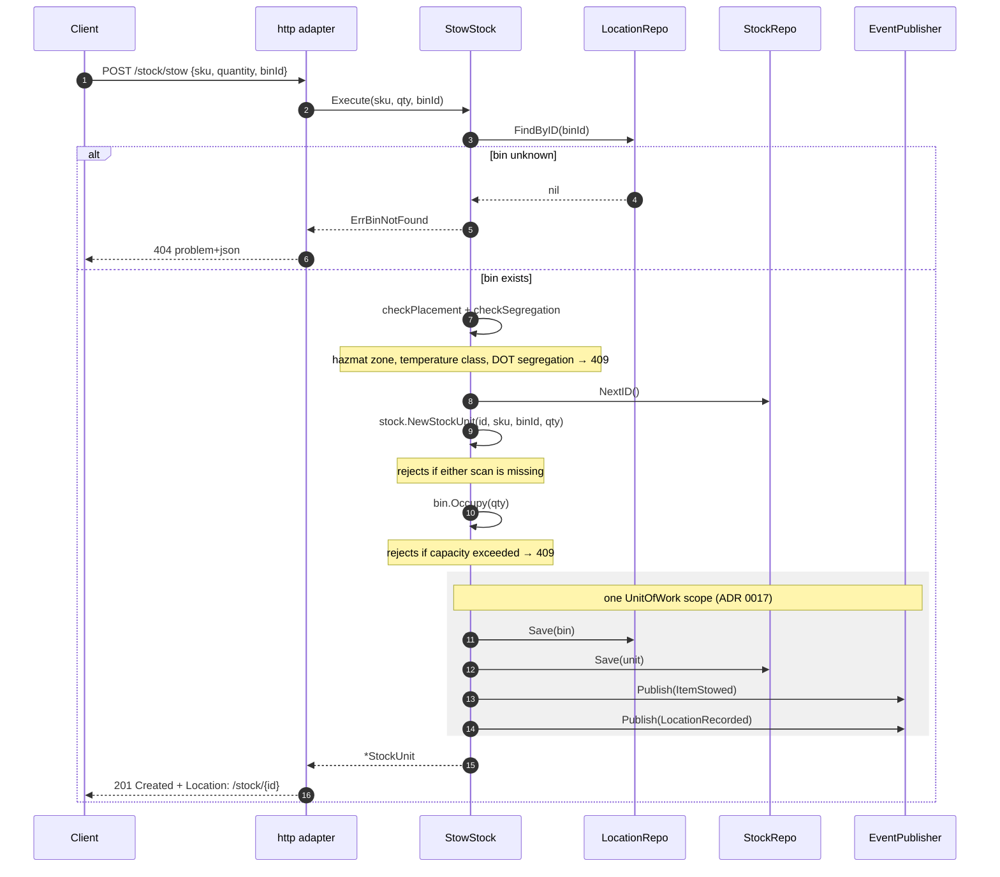
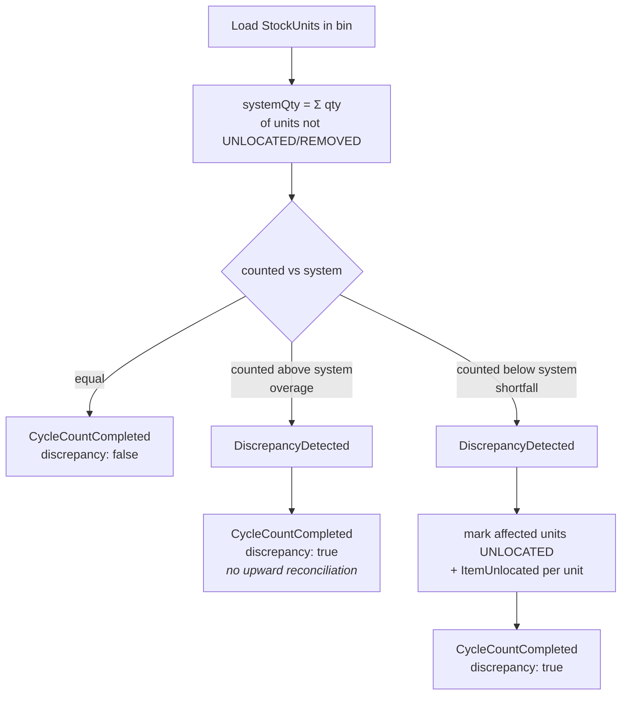

# Use Cases

Nineteen use cases, one struct each, in `internal/application/usecases`. Each
depends only on the domain and on `application/ports` — never on an adapter.
Dependencies are plain struct fields, wired once per binary in
`cmd/inventory/main.go` (REST) and `cmd/mcp/main.go` (MCP, which wires
`GetUsable`, `RevokeReservation` and `GetRelocation` only).

| # | Use case | HTTP | MCP tool | Emits |
| --- | --- | --- | --- | --- |
| 1 | `ReceiveStock` | `POST /stock/receive` (deprecated in the spec; the production trigger is `ReceiptLineReceived`, #13) | — | `StockReceived` |
| 2 | `StowStock` | `POST /stock/stow` | — | `ItemStowed`, `LocationRecorded` |
| 3 | `ReserveStock` | `POST /reservations` | — | `StockReserved` (+ `ReservationExpired` via lazy expiry) |
| 4 | `RevokeReservation` | `DELETE /reservations/{id}` | `revoke_reservation` | `ReservationRevoked` (+ `ReservationExpired` via lazy expiry) |
| 5 | `ConfirmPick` | `POST /reservations/{id}/confirm-pick` (deprecated in the spec; the production trigger is `TaskCompleted`, #12) | — | `StockPicked` (+ `ReservationExpired` via lazy expiry) |
| 6 | `GetUsable` | `GET /inventory/{sku}/usable` | `check_availability`, resource `inventory://{sku}/usable` | — (read model) |
| 7 | `RunCycleCount` | `POST /bins/{binId}/cycle-count` | — | `CycleCountCompleted`, `DiscrepancyDetected`, `ItemUnlocated` |
| 8 | `ApplyProductClassification` | — (Kafka: `warehouse.product-master.events`, ADR 0034) | — | — (local copy) |
| 9 | `GetReservationsByDemandRef` | `GET /reservations?demandRef=` | — | `ReservationExpired` via lazy expiry only |
| 10 | `RegisterBin` | `PUT /bins/{binId}` | — | — (local topology master data, ADR 0025) |
| 11 | `GetBin` | `GET /bins/{binId}` | — | — (read) |
| 12 | `ConfirmPicksForOrder` | — (Kafka: `warehouse.fulfillment.events` `TaskCompleted`, ADR 0035, ADR 0036) | — | `StockPicked` per confirmed reservation via `ConfirmPick`: the picked line's reservation when the event carries `line_no`, otherwise only on the order's last pick (+ `ReservationExpired` via lazy expiry) |
| 13 | `BookInboundReceiptLine` | — (Kafka: `warehouse.inbound-receiving.events` `ReceiptLineReceived`, ADR 0037) | — | `StockReceived` through `ReceiveStock` for a `Good` line (analytics topic); a `Damaged` line raises nothing |
| 14 | `AllocateTransferStock` | — (Kafka: `warehouse.network-inventory-planning.events` `TransferAllocationRequested`, ADR 0030) | — | `TransferStockAllocated` or `TransferStockAllocationRejected` (integration topic, through the outbox) |
| 15 | `StageTransferReceipt` | `POST /transfers/{transferLineId}/receipt` | — | `TransferReceiptStaged` for a recognized `ALLOCATED` line (ADR 0033); a quarantine publishes nothing |
| 16 | `StowTransferStock` | `POST /transfers/{transferLineId}/stow` | — | `TransferStockStowed` — the only event that raises destination usable (ADR 0033) |
| 17 | `RelocateStock` | `POST /relocations` (Idempotency-Key) | — | `StockRelocated` (integration topic, through the outbox, ADR 0039) |
| 18 | `ApplyRelocationTask` | — (Kafka: `warehouse.fulfillment.events` `TaskCompleted` with `task_type=RELOCATE`, ADR 0039) | — | `StockRelocated` through `RelocateStock` |
| 19 | `GetRelocation` | `GET /relocations/{id}` | `get_relocation` | — (read) |
| 20 | `ApplyReplenishTask` | — (Kafka: `warehouse.fulfillment.events` `TaskCompleted` with `task_type=REPLENISH`, ADR 0041) | — | `StockRelocated` (reason `REPLENISHMENT`, `source_ref` = `request_ref`) and two `BinStockLevelChanged` through `RelocateStock` |

(`RepublishProductClassifications`, the one-shot backfill, was removed at stage E
(2026-10-17); see #8.)

`PUT` and `GET /products/{sku}/classification` no longer exist (stage E,
ADR 0034), so no use case or adapter reads the local copy for REST.
The MCP `get_bin_occupancy` tool reads `StockRepo.FindByBin`
directly, without a use case.

## 1. ReceiveStock(sku, qty)

Acknowledges that goods arrived against a SKU and are staged, awaiting stow.

**Collaborators:** `EventPublisher`, `Clock`, `UnitOfWork`. Notably **no
repository** — a
receipt creates no `StockUnit`, because nothing has been located yet. Under
chaotic storage, un-located stock is not yet part of the ledger.

**Returns** a `StagedReceipt` value (`sku`, `quantity`, `receivedAt`), which is
why the endpoint answers `202 Accepted` and not `201 Created`: there is no
addressable resource to point a `Location` header at. The addressable resource
— a `StockUnit` — is created later, at stow.

**Fails when:** SKU is empty (400), quantity ≤ 0 (422).

## 2. StowStock(sku, qty, binId)

The operation that brings a `StockUnit` into existence. Validates item-scan +
location-scan and respects bin capacity.

**Collaborators:** `StockRepo`, `LocationRepo`, `EventPublisher`, `Clock`,
`UnitOfWork`, and the optional `ProductClassificationRepo` +
`LocationClassificationLookup` (placement and segregation checks below).

**Ordering matters:** the placement and segregation checks run first, then
the aggregate is constructed *before* the bin is occupied, so an invalid stow
never mutates bin occupancy. Bin and unit are then saved together, bin first,
in the same transaction as the two events' outbox rows.

**Fails when:** bin unknown (404), missing scan (400), quantity ≤ 0 (422), bin
full (409), placement or segregation rule violated (409), a concurrent writer
changed the bin first (409 `concurrent-modification`, ADR 0019).

**Placement check (ADR 0009, ADR 0013):** if the SKU has a registered
`ProductClassification`, and it carries `Hazmat` or `TemperatureSensitive`,
`StowStock` also calls `LocationClassificationLookup.GetSlotAttributes`
before persisting. Which adapter answers is chosen by
`LOCATION_LOOKUP_MODE`: `kafka` reads a local, in-memory cache fed by
facility-layout's `warehouse.facility.events` (ADR 0013 — no network call on
the stow path); `http` makes the original synchronous call to facility-layout
(ADR 0009). The mode is mandatory: the former `permissive` default (always
`Known=false`) was removed by [ADR 0042](/docs/adr/0042).

- A `Hazmat` SKU stowed into a bin whose zone is not hazmat-rated is rejected
  with `ErrHazmatZoneRequired` (409).
- A `TemperatureSensitive` SKU stowed into a bin whose zone temperature class
  does not match is rejected with `ErrTemperatureClassMismatch` (409).
- **Fail-open for unclassified/unknown bins:** `Known=false` (facility-layout
  has no record of that location — a 404 in `http` mode, an unseen or
  decommissioned slot in `kafka` mode) permits the stow.
- **Fail-closed only for classified, rule-relevant SKUs:** a lookup error
  (in practice a transport/5xx error in `http` mode; the cache itself never
  errors) surfaces as `ErrLocationClassificationUnavailable`
  (409) — but only when the SKU being stowed carries `Hazmat` or
  `TemperatureSensitive`. An unclassified SKU, or one with neither tag, is
  never blocked by lookup unavailability.
- **Nil-safe by construction:** `Classifications`/`LocationLookup` are
  optional struct fields. A `StowStock` built without them (every
  pre-existing unit test in this package; no deployed binary does, since
  `LOCATION_LOOKUP_MODE` is mandatory) behaves exactly as before this feature
  existed.

**Same-bin DOT segregation check (ADR 0010):** AFTER the placement check
above passes, and only when `Classifications` is wired, `StowStock` checks
whether the SKU being stowed has a registered classification with a
non-zero `DOTHazardClass`. If so, it looks up every OTHER SKU already
occupying the target bin (via `StockRepo.FindByBin`) and their
classifications (via `ProductClassificationRepo.FindBySKU`) — both already
this service's own repos, no cross-context call — and rejects with
`ErrHazmatClassIncompatible` (409) if `product.Incompatible` reports any
occupant's class as incompatible with the incoming SKU's class. An
unclassified occupant, or one with no `DOTHazardClass` recorded, never
blocks the stow (fail-open).

## 3. ReserveStock(sku, qty, demandRef)

Creates a revocable `Reservation` against **usable** inventory, drawing
first-fit across the SKU's `StockUnit`s.

**Collaborators:** `StockRepo`, `ReservationRepo`, `EventPublisher`, `Clock`,
`ReservationMetrics`, `UnitOfWork`, plus a `Timeout` (defaults to
`DefaultReservationTimeout`, 30 minutes).

The algorithm:

1. **Replay guard.** Load every reservation for the `demandRef`, lazily
   expire any timed-out `ACTIVE` one (see #9), and if an `ACTIVE`
   reservation for the *same* `(sku, quantity)` remains, return it unchanged —
   a client retry never double-reserves. A different SKU or quantity under
   the same `demandRef` is another order line, never a retry
   (`isReplayOf`). When the request names its line (`lineNo`, ADR 0036) the line
   must match too, so two lines of one order with the same SKU and quantity stay
   two reservations; an `ACTIVE` reservation with no line still answers a
   line-aware retry (no double hold across the deploy). This guard is
   best-effort: two concurrent first attempts
   can both pass it (see the code comment in `reserve_stock.go`).
2. Load every `StockUnit` for the SKU.
3. Sum `Usable()` across them; if the request exceeds the sum, fail early with
   `ErrInsufficientUsable` — **before** mutating anything.
4. Walk the units, taking `min(remaining, unit.Usable())` from each, recording
   an `Allocation{StockUnitID, BinID, Quantity}` per unit touched — `BinID`
   is the pick location (ADR 0025).
5. Mint a reservation id and construct the `Reservation` with
   `expiresAt = now + timeout`, then, inside one `UnitOfWork` scope, save every
   touched unit, save the reservation and publish `StockReserved`. The unit
   saves are inside the use case's own scope, so atomicity does not depend on
   the idempotency middleware's transaction already being on the context
   (REST); a failed reservation save or publish rolls the unit saves back for
   every caller.

A single reservation therefore **may span multiple bins** — covered by
`TestReserveStock_SpansMultipleStockUnits`. That is the point: SKU-scoped
allocation is what makes a later revoke re-satisfiable from a different
holding.

**Fails when:** quantity ≤ 0 (422), empty `demandRef` (400
`missing-demand-ref`, in the handler), `lineNo` present but outside 1..2147483647 (400
`invalid-line-no`; the use case entry point is `ExecuteForLine`, `Execute` is the
same without a line), usable insufficient (409), SKU has no
stock at all (409), concurrent modification of a touched unit (409).

## 4. RevokeReservation(reservationId)

Cancels a reservation and returns its quantity to usable.

**Collaborators:** `StockRepo`, `ReservationRepo`, `EventPublisher`, `Clock`,
`ReservationMetrics`, `UnitOfWork`. Reached over REST and through the MCP
`revoke_reservation` tool (same use case, same collaborators).

It first runs lazy expiry on the loaded reservation (a timed-out `ACTIVE` one
becomes `EXPIRED`, its quantity is released and `ReservationExpired` is
raised — the revoke then fails with `ErrAlreadyResolved`). Otherwise it calls
`Reservation.Revoke()` (which refuses anything not `ACTIVE`), then, inside one
`UnitOfWork` scope, walks the recorded `Allocation`s and calls
`StockUnit.ReleaseReservation(qty)` on each — exact, per-unit restitution —
saving each unit and finally the reservation, then publishes
`ReservationRevoked`.

**Fails when:** reservation unknown (404), already confirmed/revoked/expired
(409 `ErrAlreadyResolved`), a referenced stock unit is missing (404).

## 5. ConfirmPick(reservationId)

Consumes the reservation: the stock physically left the bin.

**Collaborators:** `StockRepo`, `LocationRepo`, `ReservationRepo`,
`EventPublisher`, `Clock`, `UnitOfWork`.

Unlike revoke, this touches **three** aggregates. After lazy expiry, it calls
`Reservation.Confirm(now)` (refusing an already-resolved or expired
reservation) and then, inside one `UnitOfWork` scope, for each allocation
calls `StockUnit.Pick(qty)` — which decrements both reserved and on-hand
quantity and transitions the unit to `PICKED` or `REMOVED` — and
`Bin.Release(qty)`, because units that left the bin free up physical capacity
for a future stow. It then saves the reservation and publishes `StockPicked`.

**Fails when:** reservation unknown (404), already resolved (409), expired
(409 `ErrExpired`), a referenced stock unit or bin is missing (404).

**Trigger.** Operators and the `e2e-tests` simulator call
`POST /reservations/{id}/confirm-pick`. In production the trigger is
fulfillment-execution's `TaskCompleted`, consumed by `ConfirmPicksForOrder`
(#12 below), which calls this use case once per reservation it confirms (the
picked line's when the event carries `line_no`, the order's when its last pick
completes) — never a sync
REST/MCP call from a sibling. Decided 2026-10-06, implemented by
[ADR 0035](/docs/adr/0035) (supersedes ADR 0032), per line since
[ADR 0036](/docs/adr/0036).

## 6. GetUsable(sku)

The read model. Loads every `StockUnit` for the SKU and sums `Usable()`.

**Collaborators:** `StockRepo` only — no clock, no publisher, no writes.

It never 404s on an unknown SKU: a SKU with no stock has usable 0, which is a
true and useful answer, not an error.

## 7. RunCycleCount(binId, countedQty)

Reconciles a bin's physical contents against system records.

**Collaborators:** `StockRepo`, `EventPublisher`, `Clock`, `UnitOfWork`.

Two deliberate choices are visible here:

- **Overage is reported, never auto-reconciled.** More stock present than
  recorded means goods entered without a receipt; inventing `StockUnit`s to
  match would corrupt the ledger. The discrepancy is raised for a separate
  receiving/audit process.
- **Shortfall marks whole units `UNLOCATED`**, not partial quantities. It is a
  conservative simplification that under-reports usable rather than
  over-reporting it, and it is recorded as such in the code.

Already-`UNLOCATED` and `REMOVED` units are excluded from `systemQty` — you
cannot lose the same stock twice.

## 8. ApplyProductClassification (replaces ClassifyProduct, ADR 0034)

product-master owns product classification since
[ADR 0034](/docs/adr/0034); `ClassifyProduct` is removed and
`PUT /products/{sku}/classification` is gone with it (stage E, 2026-10-17).
`ApplyProductClassification` is the use case behind the
`warehouse.product-master.events` consumer: it keeps this service's local
copy of a SKU's `ProductClassification`, the copy `StowStock` reads.

**Collaborators:** `ProductClassificationLocalCopy`, `ProcessedEventRepo`,
`UnitOfWork`.

**Atomic and idempotent:** the CloudEvents `id` is claimed in
`processed_events` and the row is upserted in ONE unit of work. The upsert
applies only when the message's `version` is greater than the stored one
(legacy rows are version 0), so redeliveries and out-of-order messages are
harmless. No domain event is raised.

**Fails when:** the message breaks the classification invariants (built by
the aggregate constructor `product.New`, as before) or carries no id or a
version below 1 — `ErrMalformedProductClassification`, which the consumer
logs and commits past; a database error is transient and retried.

`RepublishProductClassifications` and the `republish-product-classifications`
subcommand (the one-shot backfill of the legacy `ProductClassified`) were
removed at stage E (2026-10-17); no use case or `cmd/` subcommand remains.

`StowStock` (#2 above) is the consumer of this master data at stow time.

**Publishes** nothing: the per-write publication of
[ADR 0031](/docs/adr/0031) ended with [ADR 0034](/docs/adr/0034), the backfill
went with stage E, and siblings read product-master's `ProductClassified`
instead of this service.

## 9. GetReservationsByDemandRef(demandRef)

Returns every `Reservation` ever created against a caller-supplied
`demandRef` — the read side of the fleet's Order Lifecycle console
([ADR 0012](/docs/adr/0012-adopt-mfe-console-architecture)).

**Collaborators:** `ReservationRepo`, plus `StockRepo`, `EventPublisher`,
`Clock` and `UnitOfWork` for lazy expiry.

A `demandRef` can have several reservations over its lifetime (a revoke
followed by a retry), so the result is always an array; an unknown
`demandRef` returns `200` with an empty array, never `404`.

**Lazy expiry happens here.** Before returning, every `ACTIVE` result past
its `expiresAt` is transitioned to `EXPIRED`, its allocations are released
back to usable and `ReservationExpired` is published — each expired
reservation in its own `UnitOfWork` scope (`expireAllIfDue`), so one
failure never rolls back an earlier, already-committed expiry. The same
helper runs inside `ReserveStock`'s replay guard, `RevokeReservation` and
`ConfirmPick`; there is no background sweeper.

**Fails when:** `demandRef` is missing (400 `missing-demand-ref`).

## 10. RegisterBin(binId, capacity)

Declaratively brings a coded slot under this service's management
([ADR 0025](/docs/adr/0025-bin-registration-endpoint-and-pick-location)).

**Collaborators:** `LocationRepo`, `UnitOfWork`.

Inside one `UnitOfWork` scope it reads the bin and converges it to the
requested capacity: an absent bin is created with `location.NewBin`
(`BinCreated` → `201`), the same capacity is a no-op (`BinUnchanged` →
`200`), a different capacity calls `Bin.Resize` (`BinResized` → `200`). No
domain event is raised — bin registration is local topology master data and
the AsyncAPI contract is unchanged.

**Fails when:** empty bin id (400), capacity missing (400
`capacity-required`), capacity ≤ 0 (422 `invalid-bin-capacity`), capacity
above `int32` (422 `capacity-out-of-range`), capacity below current occupancy
(409 `capacity-below-occupancy`), a racing stow changed the bin first (409
`concurrent-modification`).

## 11. GetBin(binId)

Side-effect-free read of a bin's capacity and occupancy; the HTTP adapter
adds `available = capacity - occupied`.

**Collaborators:** `LocationRepo` only.

**Fails when:** empty bin id (400), unknown bin (404 `bin-not-found`) —
unlike `GetUsable`, there is no meaningful "empty" bin to return.

## 12. ConfirmPicksForOrder(eventId, taskType, orderRef, lineNo?) (ADR 0035, ADR 0036)

Turns "a PICK task for order X completed" into the physical decrement of the
right reserved stock: exactly the picked line's (ADR 0036) when the event names
its line, the order's on the last pick otherwise (ADR 0035). It is the use case
behind the `warehouse.fulfillment.events` consumer; fulfillment-execution's
`TaskCompleted` carries `task_type` and the additive optional `order_ref`, which
is the OrderId order-management reserved against (a reservation's `demand_ref`),
and the additive optional `line_no`, the order line the task was for. A PICK task
is per order **line** and every one carries the same `order_ref`. Since ADR 0036 a
`Reservation` stores its `line_no` (sent by order-management as `lineNo`), so a
task that carries `line_no` maps to exactly its reservation. A task without it, or
a reservation without it (created before migration 0035), cannot be matched, and
the order's picks are counted instead (the ADR 0035 fallback below).

**Collaborators:** `ReservationRepo` (`FindByDemandRef`), `OrderPickProgressRepo`
(`RecordPick`, table `order_pick_progress`, fallback only), `ConfirmPick` (reused
for every confirmation, its rules are not duplicated), `StockRepo`,
`EventPublisher`, `Clock` (lazy expiry, counter timestamp), `ProcessedEventRepo`,
`UnitOfWork`, `PickConfirmationMetrics`.

**Does nothing** (a successful no-op) when `task_type` is not exactly `PICK`,
when `order_ref` is empty (a producer that predates the field), or when no
reservation carries that `demand_ref` (a transfer, whose demand ref is
namespaced, or a non-inventory order). No progress row is left for an order
that has no reservation, or only `REVOKED`/`EXPIRED` ones.

**Per line (event has `line_no`, ADR 0036).** Among the order's reservations,
those with `line_no` equal to the event's are walked in id order: `ACTIVE` is
confirmed through `ConfirmPick` (normally exactly one; earlier attempts of the line
are `REVOKED`), `CONFIRMED` and `REVOKED` are skipped, `EXPIRED` — or `ACTIVE` past
its timeout, which lazy expiry resolves first (stock returned,
`ReservationExpired` raised) — is skipped, logged and counted in
`inventory.pick_confirmations{outcome=expired}`, never an error (outcome
`LINE_SETTLED`). **Nothing is counted** and no `order_pick_progress` row is
written; the order's other lines are not touched, so lines 1 and 3 picked
confirms 1 and 3 and leaves 2 `ACTIVE`. If no reservation carries the line but
the order has reservations with **no** `line_no`, the counting below applies to
those line-less reservations only; if it has none, the event is a no-op
(`LINE_NOT_FOUND`).

**Counting fallback (event without `line_no`, or only line-less reservations can
serve it; ADR 0035).** For a claimed event the pick is counted
(`picked_tasks = picked_tasks + 1`) and compared with
`needed = count(ACTIVE) + count(CONFIRMED)` of the counted reservations (`REVOKED`
and `EXPIRED` are never picked, so an order with one revoked line needs one pick
fewer). While `picked_tasks < needed` the event only records progress and
returns success (`AWAITING_LAST_PICK`). If the count has reached `needed` but no
reservation is `ACTIVE` any more, it is a no-op (`NOTHING_TO_CONFIRM`). On the
last pick each counted reservation is walked exactly as above.

**Atomic and idempotent:** the CloudEvents `id` claim in `processed_events`
(consumer `task-completed-confirm-pick`), the counter increment (fallback only)
and every confirmation commit in ONE unit of work, so a failure un-claims the id,
un-counts the pick and the redelivery is applied in full. A redelivered id is
skipped by the claim before anything is touched, so it can never be counted twice;
a new id for a line or an order that is already confirmed only finds reservations
that are no longer `ACTIVE`.

**Retention.** `order_pick_progress` rows older than
`ORDER_PICK_PROGRESS_RETENTION` (default 30 days, by `updated_at`) are deleted by
the housekeeping sweeper (ADR 0026). A row swept while its order is still being
picked restarts the count, which can only delay the confirmation (the
reservations then expire lazily), never make it early. The per-line path writes no
row.

**Fails when:** the event has no id, or its `line_no` is outside 1..2147483647 (the 32-bit column)
(`ErrMalformedPickCompletion`, which the consumer dead-letters at once; a
non-integer `line_no` fails to decode and is dead-lettered the same way); a
database error is transient and retried (5 attempts, then dead-lettered).

**Limitations:** short picks are not modelled. A Task carries no SKU or quantity,
so the whole reserved quantity of a confirmed line is picked. The counting
fallback assumes one PICK task per live reservation (true today: one per order
line) and keeps ADR 0035's "one pick early" edge (a line revoked or expired while
its task is still being worked); the per-line path has no such edge.

## 13. BookInboundReceiptLine(eventId, receiptId, asn, lineNo, sku, qty, condition) (ADR 0037)

Turns a counted receipt line from inbound-receiving into staged stock. A
`condition=Good` line runs the **existing `ReceiveStock`** (rules are not
duplicated): `StockReceived` on the analytics topic, the quantity staged and
not yet usable, stow still the RF action — the same effect as
`POST /stock/receive`. A `Damaged` line is claimed but **not booked** in v1
(outcome `DAMAGED_NOT_BOOKED`, INFO log, counted in
`inventory.inbound_receipt_units{outcome=damaged_not_booked}`); units are
counted only after the transaction commits, so a rolled-back attempt never
inflates the counter.

**Collaborators:** `ReceiveStock` (as a `stockReceiver` interface),
`ProcessedEventRepo`, `UnitOfWork`, `InboundReceiptMetrics` (optional).

**Atomic and idempotent:** the CloudEvents `id` claim in `processed_events`
(consumer name `inbound-receipt-line`) and `ReceiveStock`'s outbox write
commit in ONE unit of work (ReceiveStock's own bracket joins it), so a
redelivery is skipped by the claim and can never double-book.

**Fails when:** no event id, empty SKU, quantity ≤ 0 or a `condition` outside
`Good | Damaged` (`ErrMalformedInboundReceiptLine` — deterministic: the
consumer logs it and commits past, never retries); a repository error is
transient and retried.

## 14. AllocateTransferStock(command) (ADR 0030)

The command/reply leg of the site-scoped transfer saga: holds origin-site
stock for a planning transfer line and answers with a ledgered outcome,
`ALLOCATED` or `REJECTED`, **exactly once per `transfer_line_id`**.

**Collaborators:** `StockRepo`, `ReservationRepo`, `TransferAllocationRepo`
(the `transfer_allocations` ledger), `EventPublisher`, `Clock`, `UnitOfWork`.

**Idempotency is database-level, not use-case-level:** the ledger row is
unique on `transfer_line_id`, and the entire decision — stock decrements, the
`Reservation` holding the stock, the ledger row and the outbox rows for the
reply — commits in ONE unit of work. A replayed command either finds the
ledger row on the read path (returns the original outcome, touches nothing)
or races the insert and fails on the unique constraint (re-reads the original
and returns it), so a line can never be decided — or stock double-decremented
— twice. This is exactly what the scripted-race suite in
`transfer_race_and_error_branches_test.go` pins: the in-transaction
re-checks, the unique-constraint race recovery, and error propagation from
every port the happy-path tests never fail.

Stock without a recorded site (rows persisted before the site migration)
answers `ORIGIN_SITE_UNKNOWN` while continuing to serve ordinary demand.

**Fails when:** the command is malformed (empty ids, non-positive quantity —
`ErrMalformedTransferCommand`, deterministic, committed past); insufficient
usable at the origin site answers `REJECTED`/`INSUFFICIENT_USABLE` (a reply,
not an error); the same line id with a different payload answers
`REJECTED`/`IDEMPOTENCY_CONFLICT`.

## 15. StageTransferReceipt(command) (ADR 0033)

The destination-receiving half: a destination site scanned an arrival and
counted `receivedQuantity` against a transfer line. The lookup key is the
`transfer_allocations` ledger row for the line — the same anchor the origin
side decided against.

**Collaborators:** `TransferAllocationRepo`, `TransferReceiptRepo`,
`InventoryExceptionRepo`, `EventPublisher`, `Clock`, `UnitOfWork`.

- **Recognized `ALLOCATED` row** → a `transfer_receipts` row is created
  (`STAGED`, `expected_quantity` from the ledger, `variance = received −
  expected` SIGNED) and `TransferReceiptStaged` is published through the
  same transactional outbox. **No usable stock moves at stage.**
- **Quarantine** — no ledger row (never allocated here), a `REJECTED` row, a
  `transferId` mismatch, or a destination equal to the transfer's own origin
  site → an `inventory_exceptions` row is written, nothing that could raise
  availability is published, and the caller gets an explicit problem
  (422 with the exception's coordinates). A quarantine is a **committed
  outcome, not a rollback**; a repeated identical quarantined scan is a
  benign replay.

**Idempotency is database-level:** the receipt row is unique on the line id.
A replayed identical stage returns the original receipt (`Replay=true`)
touching nothing; the same id with a different payload is refused
(`ErrTransferReceiptConflict`).

**Fails when:** the command is malformed (`ErrMalformedReceiptCommand`);
see quarantine cases above (`ErrTransferLineUnrecognized`,
`ErrTransferNotAllocated`, `ErrTransferWrongDestination`).

## 16. StowTransferStock(lineId, bins) (ADR 0033)

Places a `STAGED` receipt's goods into destination bins — the **only** path
that raises the destination site's usable stock for a transfer, exactly once
per line. Rules, in order:

1. The receipt must exist and be `STAGED` (stow-before-stage is
   `ErrReceiptNotStaged`; an already-`STOWED` receipt is the replay case).
2. Every requested bin must be registered and belong to the receipt's
   `destination_site_id` — site custody fails closed: another site's bin or a
   legacy site-less bin rejects with `ErrBinWrongSite` (409).
3. The bin quantities must sum **exactly** to `received_quantity`
   (`ErrStowQuantityMismatch`): a partial stow would strand dock stock, a
   padded one would invent it.
4. One `StockUnit` per bin leg is created **at the destination site**, bin
   occupancy is taken, the receipt moves `STAGED → STOWED` and
   `TransferStockStowed` is published — all in ONE unit of work.

**Idempotency is database-level:** a replayed stow returns the original
stow legs and `StockUnit`s (`Replay=true`), creates no second `StockUnit`
and publishes nothing new; a concurrent double-stow loses the state-guard
race and is routed to the replay path.

**Fails when:** malformed command (`ErrMalformedStowCommand`), receipt not
staged (409), wrong-site bin (409), quantity mismatch (409).

## 17. RelocateStock(siteCode?, sku, fromBin, toBin, qty, reason, sourceRef) (ADR 0039)

Moves a quantity of one SKU from one bin to another bin **of the same site**:
the physical step of a slot-plan move (slotting-optimization ADR 0010), a
consolidation or a manual move. Site-level on-hand and usable do not change;
the stock's location does.

**Collaborators:** `StockRepo`, `LocationRepo`, `RelocationRepo` (table
`relocations`), `EventPublisher`, `Clock`, `UnitOfWork`.

**Rules, in order.** Both bins are loaded **first**, so an unknown bin is
always `ErrBinNotFound` (404) whatever else is wrong. The site is the command's
`siteCode`, or (the RELOCATE-task path) the source bin's `EffectiveSite`: its
recorded custody, else the first segment of a seven-segment `LocationCode`; a bin
with neither has no site and is rejected. Then the `Relocation` aggregate
checks: both bins in the site (`ErrBinNotAtSite`), `from_bin != to_bin`
(`ErrSameBin`), quantity > 0, reason in `SLOTTING | CONSOLIDATION | MANUAL`,
`source_ref` ≤ 200 characters. `Apply` draws the quantity from the **usable**
(unreserved) quantity of the SKU's units in the source bin, ascending unit id —
reserved stock never moves, because a reservation's allocation names its bin as
the pick location (`stock.ErrInsufficientUsable` otherwise) — releases the source
bin's occupancy, occupies the destination bin (`location.ErrBinFull` over
capacity) and creates **one new StockUnit** at the destination. A source unit
that reaches zero becomes `REMOVED`.

**Atomic and concurrent-safe:** both bins, every touched source unit, the new
destination unit, the `relocations` row and the `StockRelocated` outbox row are
saved in ONE unit of work; every save is version-guarded (ADR 0019), so a
concurrent writer on either bin or a touched unit fails the whole move with
`ErrConcurrentModification` (409) and nothing moved.

**Idempotency:** `POST /relocations` is behind the Idempotency-Key middleware
(ADR 0018); the RELOCATE-task path dedupes on the CloudEvents id (#18).

## 18. ApplyRelocationTask(eventId, taskId, taskType, sku, fromBin, toBin, qty, relocationRef) (ADR 0039)

Applies a completed `RELOCATE` task from fulfillment-execution's
`TaskCompleted` to the ledger. It is the RELOCATE branch of the same consumer
(group, DLQ, shutdown semantics) that drives #12; PICK completions are never
sent here and behave exactly as before. The additive TaskCompleted fields
`sku`, `from_bin`, `to_bin`, `quantity` and `relocation_ref` (decision E1,
emitted for RELOCATE tasks only) become a `RelocateStock` command with reason
`SLOTTING`, no `siteCode` (TaskCompleted carries none, so the source bin's site
applies) and `source_ref` = `relocation_ref`, or the task id when absent.

**Collaborators:** `RelocateStock` (#17, rules not duplicated),
`ProcessedEventRepo`, `UnitOfWork`.

**Atomic and idempotent:** the CloudEvents `id` claim in `processed_events`
(consumer `task-completed-relocate`) and the whole move commit in ONE unit of
work. A redelivered id is skipped by the claim (outcome `DUPLICATE`); a failure
un-claims the id and the redelivery is applied in full.

**Fails when (deterministic, `ErrMalformedRelocationTask`, dead-lettered at
once):** no event id; empty or invalid `sku`, `from_bin` or `to_bin`; missing or
non-positive `quantity`; and every ledger rejection of #17 — unknown bin, bin not
in the site, same bin, insufficient usable at the source, destination full,
`relocation_ref` too long. **Transient** (retried, 5 attempts, then DLQ): a
database error or `ErrConcurrentModification`. A shutdown mid-move commits
nothing and dead-letters nothing. A task type other than `RELOCATE` is a no-op
(`IGNORED`).

**Limitation:** dedupe is per CloudEvents id. Two different completions for the
same `relocation_ref` would move twice; fulfillment-execution publishes one
completion per task, and the ref is stored on the relocation for audit.

## 19. GetRelocation(id) (ADR 0039)

Reads one applied relocation (`RelocationRepo.FindByID`): site, SKU, bins,
quantity, reason, source ref, the source legs drawn and the destination
StockUnit. Unknown id → `ErrRelocationNotFound` (`404 relocation-not-found`, or
the MCP tool error). Backs `GET /relocations/{id}` and the read-only MCP tool
`get_relocation`.

## 20. ApplyReplenishTask(eventId, taskId, taskType, sku, fromBin, toBin, qty, requestRef) (ADR 0041)

Applies a completed `REPLENISH` task (pick-face replenishment) from
fulfillment-execution's `TaskCompleted` to the ledger. It is the REPLENISH
branch of the same consumer (group, DLQ, shutdown semantics) as #12 and #18,
and a sibling of #18: the same `RelocateStock` (#17, rules not duplicated), with
three differences. The reason is `REPLENISHMENT` (system-set: `POST /relocations`
rejects it); `source_ref` is the additive `request_ref` (the replenishment
request id), **required** with no task-id fallback (blank = malformed); and the
CloudEvents `id` is claimed under consumer `task-completed-replenish`.

**Collaborators:** `RelocateStock` (#17), `ProcessedEventRepo`, `UnitOfWork`.

**Atomic and idempotent:** the claim, both bins, the stock units, the
`relocations` row and the `StockRelocated` plus two `BinStockLevelChanged`
(`REPLENISHMENT`, source bin then destination) outbox rows commit in ONE unit of
work; a redelivered id is `DUPLICATE`, a failure un-claims the id.

**Fails when (deterministic, `ErrMalformedRelocationTask`, dead-lettered at
once):** the failures of #18, plus a missing or blank `request_ref`.
**Transient:** as #18. A task type other than `REPLENISH` is a no-op (`IGNORED`).

## Cross-cutting patterns

**Errors are typed values, mapped once.** Use cases return sentinel errors
(`ErrStockUnitNotFound`, `ErrBinNotFound`, `ErrReservationNotFound`,
`ErrInsufficientUsable`) or domain errors; only the HTTP adapter knows about
status codes. See [ADR 0005](/docs/adr/0005-rfc-7807-problem-details).

**Time is injected.** Every `occurredAt` and every `expiresAt` comes from the
`Clock` port, so tests pin time rather than sleeping.

**State change and events commit together.** Every writing use case brackets
its `Save`(s) and `Publish`(es) in `ports.UnitOfWork` via the `atomically`
helper (ADR 0017). In every binary `Publish`
inserts `outbox_events` rows in that same transaction (Postgres is the only
runtime, [ADR 0042](/docs/adr/0042)); a relay delivers them
later. A nil `UnitOfWork` exists only in unit tests, where it simply runs the
function.

**Writes are version-guarded.** `StockRepo`, `LocationRepo` and
`ReservationRepo` `Save` only when the row's `version` still matches what was
loaded; a lost race surfaces as `ErrConcurrentModification` → `409`
(ADR 0019).

**Publish failures propagate.** If `EventPublisher.Publish` returns an error,
the use case returns it — there is a dedicated
`Test*_EventPublishFails_PropagatesError` test for each. Events are not
fire-and-forget.

**Every repository failure is tested.** The `usecases` package has an explicit
`Test*_<Repo><Method>Fails_PropagatesError` per collaborator call, which is
how the package reaches its coverage bar without relying on happy paths.
