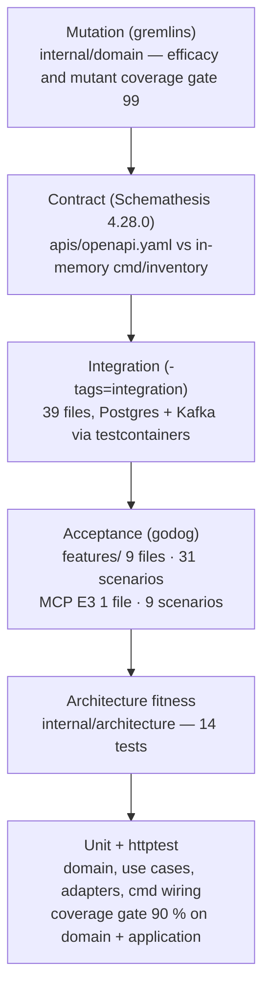

# Testing

Counts below were taken from the tree on this branch: 140 `*_test.go` files, of
which 39 carry the `integration` build tag; 9 Gherkin files with 31 scenarios
under `features/`, plus 1 MCP feature file with 9 scenarios.



Source: `Makefile`, `.github/workflows/ci.yml`, `.gremlins.yaml`, `features/`, `internal/architecture/`.

## Make targets

`make help` prints the list. Every target mirrors a CI job.

| Target | Runs | Needs |
| --- | --- | --- |
| `make build` / `make vet` | `go build ./...` / `go vet ./...` | Go |
| `make fmt` / `make fmt-check` | `gofmt -w .` / fail on any unformatted file | Go |
| `make lint` | `golangci-lint run ./...` (CI pins v2.13.1) | golangci-lint |
| `make test` | `go test ./... -race` — unit, httptest, both godog suites, MCP evals, fitness tests | Go only (in-memory adapters) |
| `make coverage` | `make test` with `-coverpkg=./internal/domain/...,./internal/application/...` and the **90 %** gate | Go |
| `make bdd` | `go test ./... -run TestFeatures -v` (the REST acceptance suite) | Go |
| `make arch-test` | `go test ./internal/architecture/... -v` | Go |
| `make integration` | `go test -tags=integration ./... -race -count=1` | Docker (testcontainers boots Postgres / Kafka per suite; no `DATABASE_URL`, no compose) |
| `make contract` | `scripts/contract-test.sh` | `pip install 'schemathesis==4.28.0'` |
| `make mutation` | `gremlins unleash ./internal/domain/stock` | gremlins v0.6.0 |
| `make mutation-full` | `gremlins unleash ./internal/domain --workers 1 --timeout-coefficient 30` | gremlins v0.6.0 |
| `make vuln` | `govulncheck ./...` | govulncheck |
| `make check` | `fmt-check vet build lint test` | — |
| `make check-all` | `check` + `coverage arch-test bdd` | — |
| `make check-fast` | `fmt-check vet arch-test` + tests of packages changed vs `HEAD` | — (agent Stop hook) |
| `make guide-lint` / `make harness-test` | `scripts/harness/guide_lint.py` / `scripts/harness/test_hook.py` | Python 3 |

Git hooks (`lefthook.yml`, after `lefthook install`): **pre-commit** runs
`make fmt-check`, `make vet`, `make lint`; **pre-push** runs `make check`.
Neither runs `integration` or `mutation`.

## The layers

### Unit and handler tests

Plain `go test` with the in-memory adapters and fixed clocks: aggregates and
value objects in `internal/domain/*`, use cases in
`internal/application/usecases`, the HTTP handlers through `httptest`
(`internal/adapters/inbound/http`), Kafka consumers against fake readers,
publishers' encoding (including the `events/testdata/log_publisher_golden.json`
golden), and composition-root wiring in `cmd/inventory/*_test.go` and
`cmd/mcp/*_test.go`. CI enforces 90 % statement coverage over the domain and
application packages.

### Acceptance (BDD)

`features_test.go` runs every `features/*.feature` with godog against a fresh
in-memory `cmd/inventory` router — a black-box test of the REST API
([ADR 0007](../adr/0007-godog-bdd-acceptance-tests.md)).

| Feature file | Scenarios |
| --- | --- |
| `bin_registration.feature` | 7 |
| `cycle_count.feature` | 3 |
| `demand_ref.feature` | 4 |
| `product_classification.feature` | 4 |
| `receive.feature` | 1 |
| `reservation.feature` | 4 |
| `reservation_expiry.feature` | 4 |
| `stow.feature` | 3 |
| `usable_inventory.feature` | 1 |

### MCP evals

Three layers over `cmd/mcp`'s server ([ADR 0027](../adr/0027-mcp-eval-and-governance-suite.md)),
all in `internal/adapters/inbound/mcp`:

- **E1 schema and registry** (`eval_governance_test.go`): input schemas resolve
  and constrain, every parameter is described, the registry matches
  `testdata/tool_registry.golden` (name, read-only, destructive), and tool names
  are unique against `testdata/fleet_tool_snapshot.golden`.
- **E2 wire conformance** (`eval_conformance_test.go`): initialize handshake,
  unknown tool / resource / prompt rejected, wrong-typed and extra arguments
  rejected, resource template and prompt discovery, session close.
- **E3 behaviour** (`evalsuite_test.go`): `testdata/features/mcp_tools.feature`
  (9 scenarios) through godog.

They run in `make test` and again, by name, in the `evals-tests` CI job.

### Architecture fitness

`internal/architecture` ([ADR 0006](../adr/0006-arch-go-fitness-tests.md),
[ADR 0029](../adr/0029-extra-architecture-fitness-tests.md)):

| Test | Guards |
| --- | --- |
| `TestHexagonalArchitecture` | arch-go layering: domain imports nothing internal; application only domain; inbound and outbound adapters never import each other; nothing imports `cmd`; `ports` holds only interfaces; the analytics region is isolated. |
| `TestMCPAdapterDependencyRule` | The MCP adapter depends only on the application and domain layers, and nothing else imports it ([ADR 0008](../adr/0008-mcp-inbound-adapter.md)). |
| `TestNoAuthMiddlewareReintroduced` | No auth middleware on REST or MCP (the fleet is unauthenticated). |
| `TestKafkaConsumerGroupNeverHardcodedInline` | Consumer group ids are named constants or configuration. |
| `TestKafkaIntegrationTestsUseTestcontainers` (+ detector test) | Kafka integration tests boot their own broker (checked per file). |
| `TestPostgresIntegrationTestsUseTestcontainers` (+ detector test) | Postgres integration tests boot their own database (checked per package). |
| `TestEventCatalogueMatchesContract` (+ detector test) | The event catalogue in code matches the messages declared in `apis/asyncapi.yaml`. |
| `TestCloudEventsOnly` | No `EVENT_ENVELOPE_MODE` toggle anywhere, and a module that talks to Kafka imports the CloudEvents SDK. |
| `TestReplayConsumersSetCommitInterval` | A kafka-go reader on a process-unique group (the facility cache's full replay) sets `CommitInterval`. |
| `TestDomainHasNoWireStructTags` (+ detector test) | No `json:` / `db:` tags on domain types. |

### Integration (testcontainers)

39 `*_integration_test.go` files behind `//go:build integration`. Each suite
starts its own `postgres` and/or Kafka container
(`internal/testsupport/kafkatc` waits for the group coordinator before tests
run). Covered: every Postgres repository, migrations, optimistic concurrency,
the idempotency middleware (including `lineNo`), the outbox publisher and relay,
the sweeper, pool limits, rehydration, the transfer, confirm-pick, inbound
receipt and product-master hand-overs at the use-case level, the analytics
store, the facility cache consumer, publisher partitioning, the MCP
Streamable-HTTP transport, and the `cmd/inventory` housekeeping / republish and
`cmd/mcp` outbox wiring. CI runs the whole tree
(`go test -tags=integration ./... -race -count=1`) with
`TESTCONTAINERS_RYUK_DISABLED=true`.

### Contract

`scripts/contract-test.sh` builds `cmd/inventory`, starts it in-memory on
`127.0.0.1:18080` (`CONTRACT_PORT`), waits for `/healthz`, and runs
`st run apis/openapi.yaml` with up to 100 examples per operation
(`CONTRACT_MAX_EXAMPLES`) and 4 workers. Excluded: `classifyProduct` (retired,
always `410`), the `Reports` tag (served by `cmd/inventory-reports`), and the
positive-data check for the two transfer operations (a well-formed scan with no
ledger row is quarantined with `422` by design).

### Mutation

gremlins v0.6.0 with `.gremlins.yaml`: 1 worker, timeout coefficient 30, and
thresholds **efficacy 99** and **mutant-coverage 99** (gremlins fails at or
below the threshold, so a single surviving mutant fails the run). The fast
subset `./internal/domain/stock` blocks every PR (`mutation-fast`); the whole
`./internal/domain` runs weekly (`mutation`).

### Frontend and chart

`web/` (the inventory micro-frontend) has its own Vitest suite (`npm test`),
oxlint and `tsc -b`, run by the `web` job. `charts/inventory-storage/tests/test_service_selectors.py`
checks Service selectors; it is run by hand
(`python3 charts/inventory-storage/tests/test_service_selectors.py`), not by CI.

## CI jobs

`.github/workflows/ci.yml` runs on push and pull request to `main` and
`develop`, weekly (Monday 06:00 UTC) and on dispatch.

| Job | Runs | When |
| --- | --- | --- |
| `lint` | golangci-lint v2.13.1 | always |
| `guide-lint` | `guide_lint.py`, `repo_lint.py`, `test_hook.py`, `test_repo_lint.py` | always |
| `complexity` | golangci-lint with `gocyclo,gocognit,cyclop,funlen,nestif`; informational gocyclo > 10 report | always |
| `test` | build, vet, `go test ./... -race` with coverage, 90 % gate | always |
| `bdd` | `go test ./... -run TestFeatures -v` | always |
| `contract` | `scripts/contract-test.sh` | always |
| `evals-tests` | `go test ./internal/adapters/inbound/mcp/... -race -run '^TestEval\|^TestMCPEvalSuite' -v` | always |
| `integration` | `go test -tags=integration ./... -race -count=1` | always |
| `mutation-fast` | `gremlins unleash ./internal/domain/stock` | always |
| `mutation` | `gremlins unleash ./internal/domain` | schedule / dispatch only |
| `drift` | deadcode, `go mod tidy -diff`, knip on `web/`, coverage-quality report | schedule / dispatch only |
| `api-lint` | Spectral on `apis/openapi.yaml` and `apis/asyncapi.yaml` | always |
| `vuln` | govulncheck v1.1.4 | always |
| `docs-api-drift` | `npm run clean-api-docs inventory && npm run gen-api-docs inventory`, then `git diff --exit-code -- docs/api-reference/rest` | always |
| `helm-lint` | `ct lint --charts charts/inventory-storage` | pull requests |
| `arch-test` | `go test ./internal/architecture/... -v` | always |
| `web` | builds warehouse-ui-kit `develop`, then lint, `tsc -b`, test, build of `web/` | always |
| `trivy-scan` | image build + Trivy, blocking on fixable CRITICAL/HIGH | pull requests |
| `docker-publish` | push, cosign sign, SBOM attest to `ghcr.io/iqvo/inventory-storage` | push to `main` |
| `release` | next `vX.Y.Z` tag, Helm chart to `oci://ghcr.io/iqvo`, GitHub release | push to `main` |

`.github/workflows/docs.yml` builds this site (`npm ci && npm run build` in
`docs/`) on pull requests that touch `docs/**` or `apis/**`, and builds and
deploys it to GitHub Pages on push to `main`.

## Running a single layer locally

```bash
go test ./internal/domain/... -race                 # one package
go test -run TestFeatures -v .                      # REST acceptance suite only
go test -tags=integration ./internal/adapters/outbound/postgres/... -race -count=1
go test ./internal/adapters/inbound/mcp/... -run '^TestEval|^TestMCPEvalSuite' -v
CONTRACT_MAX_EXAMPLES=20 ./scripts/contract-test.sh
```
