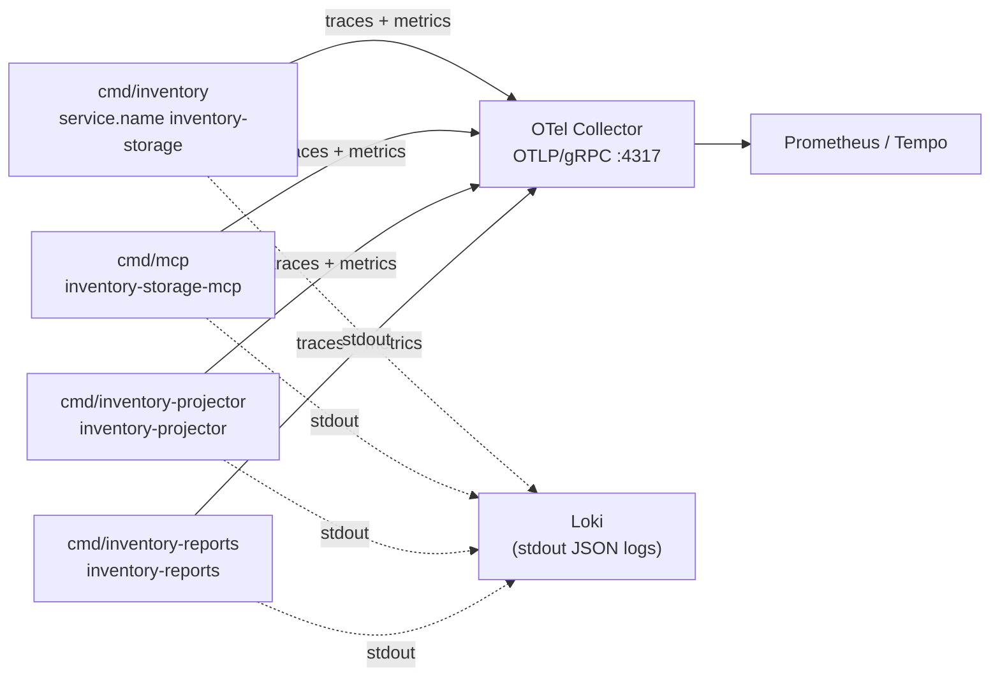

# Observability

All four binaries call the same `telemetry.Setup`
(`internal/adapters/outbound/telemetry/telemetry.go`): traces and metrics are
**pushed** over OTLP/gRPC to `OTEL_EXPORTER_OTLP_ENDPOINT` (default
`localhost:4317`; in the cluster the chart points it at
`otel-collector.observability.svc.cluster.local:4317`). There is **no
`/metrics` endpoint** and no Prometheus registry in the process: Prometheus
names such as `inventory_reservations_total` exist only after the collector
converts the OTLP stream. Metrics are exported every 15 s; export failures are
logged at DEBUG and never affect requests. Propagation is W3C `traceparent` +
`baggage`.

Every signal carries the resource attributes `service.name`
(`OTEL_SERVICE_NAME`), `service.version` (`SERVICE_VERSION`) and
`deployment.environment.name` (`ENVIRONMENT`).

Source: `internal/adapters/outbound/telemetry/telemetry.go`, `charts/inventory-storage/values.yaml` (`otel.endpoint`).

## Metrics

### Application instruments

Meter `github.com/claudioed/inventory-storage`
([ADR 0016](../adr/0016-standard-metrics-convention.md)).

| Instrument | Type | Unit | Attributes | Emitted by | Meaning |
| --- | --- | --- | --- | --- | --- |
| `inventory.reservations` | Int64 counter | `{reservation}` | `outcome` = `created` \| `revoked` | `cmd/inventory` (`ReserveStock`, `RevokeReservation`), `cmd/mcp` (`revoke_reservation`) | Reservations made against usable inventory and revoked. Source: `internal/adapters/outbound/telemetry/metrics.go`. |
| `inventory.pick_confirmations` | Int64 counter | `{reservation}` | `outcome` = `confirmed` \| `expired` \| `already_picked` \| `revoked` | `cmd/inventory`, TaskCompleted consumer | Reservations settled by a completed PICK task. Source: `pick_metrics.go`. |
| `inventory.inbound_receipt_units` | Int64 counter | `{unit}` | `outcome` = `booked` \| `damaged_not_booked` | `cmd/inventory`, inbound-receipt consumer | Units on `ReceiptLineReceived` lines, booked (Good) or counted but not booked (Damaged). Source: `inbound_receipt_metrics.go`. |
| `circuit_breaker.state` | Int64 gauge | `{state}` | `dependency` = `facility-layout` | `cmd/inventory` with `LOCATION_LOOKUP_MODE=http` | 0 closed, 1 half-open, 2 open; recorded on every state change. Source: `circuit_breaker_metrics.go`. |

### Library instruments

| Instrument | Type / unit | Attributes | Emitted by |
| --- | --- | --- | --- |
| `http.server.request.duration` | Float64 histogram, `s` (buckets 5 ms … 10 s) | `http.method`, `http.scheme`, `http.route` (chi pattern). **No status-code attribute** in otelchi v0.12.3. | `cmd/inventory`, `cmd/inventory-reports`, `cmd/mcp` (otelchi) |
| `http.server.active_requests` | Int64 up-down counter | same | `cmd/inventory-reports`, `cmd/mcp` only (the OLTP router does not register it) |
| `pgxpool.acquires`, `pgxpool.acquire_duration` (`ns`), `pgxpool.acquired_connections`, `pgxpool.idle_connections`, `pgxpool.total_connections`, `pgxpool.max_connections`, `pgxpool.empty_acquire`, `pgxpool.empty_acquire_wait_time` (`ns`), `pgxpool.canceled_acquires`, `pgxpool.constructing_connections`, `pgxpool.new_connections`, `pgxpool.max_idle_destroys`, `pgxpool.max_lifetime_destroys` | observable counters / gauges | `db.system.name`, `db.client.connection.pool.name` (`host:port/db`) | `cmd/inventory-projector` and `cmd/inventory-reports` only (`analyticsstore.RecordPoolStats`); the OLTP pool records traces but no pool metrics |
| `go.memory.used`, `go.memory.limit`, `go.memory.allocated`, `go.memory.allocations`, `go.memory.gc.goal`, `go.goroutine.count`, `go.processor.limit`, `go.config.gogc`, `go.schedule.duration` | runtime | — | all four (`go.opentelemetry.io/contrib/instrumentation/runtime` v0.71.0) |

The projector's admin server is a plain `net/http` mux: it emits no HTTP
metrics or spans.

## Traces

| Span name | Kind | Where | Notes |
| --- | --- | --- | --- |
| chi route pattern, e.g. `/reservations/{id}` | server | `cmd/inventory`, `cmd/inventory-reports`, `cmd/mcp` (otelchi) | One per HTTP request; MCP requests appear under `/mcp` or `/*`. |
| `mcp.tool <tool name>` | internal | `cmd/mcp` (`internal/adapters/inbound/mcp/tools.go`) | Attribute `mcp.tool.name`; status `Error` when the tool returns an error. |
| `kafka.publish warehouse.inventory.events` | producer | direct (no-outbox) integration publish | Attributes `messaging.system=kafka`, `messaging.destination.name`, `messaging.operation.name=publish`, `messaging.message.event_type`. |
| `kafka.publish warehouse.inventory.analytics` | producer | direct analytics publish | Same messaging attributes. |
| `kafka.consume warehouse.inventory.analytics` | consumer | `cmd/inventory-projector` | Parent extracted from the message's W3C headers. |
| `query <operation>`, `batch query …`, `connect`, … | client | every pgx pool (otelpgx v0.12.0) | One per SQL statement. |

With the transactional outbox, the trace headers written into
`outbox_events.headers` are those of the span active when the use case
committed, so downstream consumers parent onto the originating HTTP request
even though the relay sends the message later.

## Logs

Every binary logs JSON to stdout through `log/slog` (level from `LOG_LEVEL`).
Common fields: `time`, `level`, `msg`, plus `trace_id` and `span_id` whenever
the record is written with a span on the context
(`internal/adapters/outbound/telemetry/slogotel.go`).

| Message | Fields | Source |
| --- | --- | --- |
| `http request` (INFO; ERROR for 5xx) | `method`, `path`, `status`, `duration_ms`, `bytes`, `request_id` (chi `X-Request-Id`) | `internal/adapters/inbound/http/logging.go` (API and reports) |
| `domain event published` | `event_name`, `payload` | `internal/adapters/outbound/events/log_publisher.go` (`EVENT_PUBLISHER=log`) |
| `event publisher configured` | `publisher`, `integration_topic`, `analytics_topic`, `brokers` | startup |
| `outbox relay: send failed, stopping this pass at the failed row` (WARN) | `outbox_id`, `topic`, `attempts`, `error` | relay |
| `outbox relay: row reached the attempt cap and is excluded from future claims; ...` (ERROR) | `outbox_id`, `topic`, `event_type`, `key`, `attempts`, `max_attempts`, `error` | relay, once per row when it reaches `OUTBOX_MAX_ATTEMPTS` ([ADR 0038](../adr/0038-outbox-relay-attempt-cap.md)) |
| `outbox relay started` | `interval`, `max_attempts` | `cmd/inventory/adapters.go` |
| `retrying` (WARN) / `succeeded after retry` | `op`, `attempt`, `in`, `err` | `bootretry` |
| `... consumer configured` / `... not started` | `topic`, `consumer_group`, `reason` | each consumer at startup |
| `... retrying same message` (WARN), `... dead-lettering ...` (ERROR), `skipping ... not a valid CloudEvent` (WARN, sampled for TaskCompleted) | `error`, `attempt`, `partition`, `offset` | Kafka consumers |
| `facility location cache is ready` / `... ready but EMPTY ...` (WARN) | `slots`, `zones`, `topic` | `cmd/inventory/lookup.go` |
| `housekeeping sweeper started` | `interval`, `idempotency_key_ttl`, `outbox_retention`, `order_pick_progress_retention` | `cmd/inventory/housekeeping.go` |

## Dashboards

warehouse-infra provisions **Warehouse — Inventory & Storage** (uid
`warehouse-inventory-storage`) from
`terraform/dashboards/contexts/inventory-storage.json`. Rows: Kong request
rate / 5xx ratio / p95 for the `httproute.warehouse-systems.inventory-storage.*`
route; service HTTP RED by `service_name` and `http_route`; the
`inventory_reservations_total` rate by `outcome`; Go runtime goroutines and
memory; Loki log stream, volume by level, and errors/warnings.

Its per-process 5xx panel filters on `http_response_status_code` /
`http_status_code`, which otelchi v0.12.3 never sets, so that panel stays
empty; use the Kong 5xx panel or the `http request` log lines with
`status >= 500` instead.

## Suggested alerts

| Alert | Signal | Why |
| --- | --- | --- |
| Outbox backlog | `SELECT count(*), min(created_at) FROM outbox_events WHERE published_at IS NULL` growing for > 5 min | Relay is stuck on a failing row (no metric exists for this; query the DB). |
| Outbox row excluded | any ERROR `outbox relay: row reached the attempt cap ...` (log alert), or `SELECT count(*) FROM outbox_events WHERE published_at IS NULL AND attempts >= 20` > 0 | An event that consumers never received; re-arm it after fixing the cause ([Runbook](./runbook.md#an-outbox-row-hit-the-attempt-cap)). |
| facility-layout breaker open | `circuit_breaker_state{dependency="facility-layout"} == 2` for > 1 min | Stows fall back to permissive (fail-open) classification. |
| DLQ traffic | any new message on `warehouse.fulfillment.events.dlq` or `warehouse.facility.events.dlq` | Each one is a pick confirmation or a location fact that was not applied. |
| Consumer lag | lag of groups `inventory-storage-confirm-pick`, `inventory-storage-transfer-allocation`, `inventory-analytics` and the configured product-master / inbound-receipt groups | Those consumers retry a failing message in place; lag is the only symptom. |
| Analytics freshness | `GET /reports/flow-accuracy/freshness` → `lagSeconds` above an agreed bound | Projector down or behind. |
| Pick confirmations expiring | rate of `inventory_pick_confirmations_total{outcome="expired"}` | Picks completing after their reservation expired; stock was already returned to usable. |
| Damaged receipts | rate of `inventory_inbound_receipt_units_total{outcome="damaged_not_booked"}` | Inbound quality signal. |
| HTTP latency | p95 of `http_server_request_duration_seconds` by `http_route` | Note: the OLTP pool's `statement_timeout` is 5 s. |
