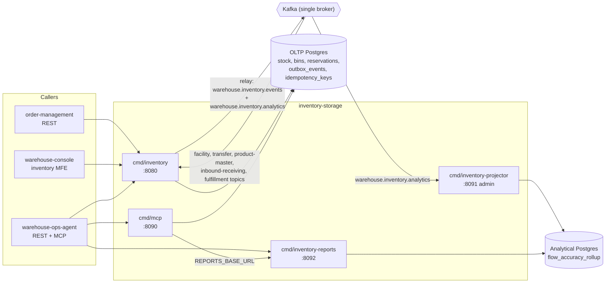
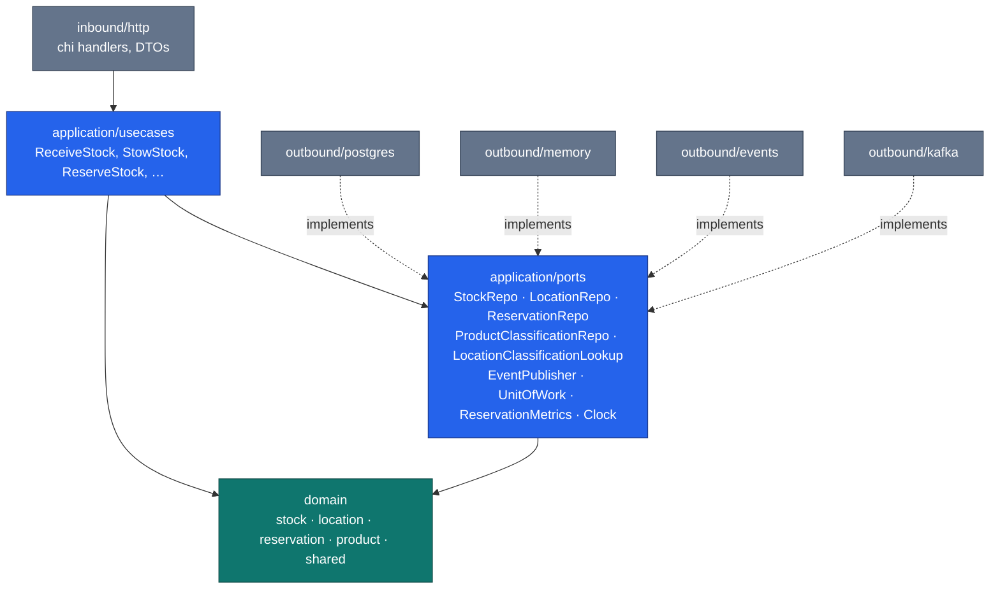

# Architecture

The service is **hexagonal (ports & adapters)** with one non-negotiable rule:

> **domain depends on nothing; application depends on domain; adapters depend
> on application/domain.**

No framework type, no `chi` router, no `pgx` connection, and no SQL string ever
appears inside `internal/domain/`.

## Layout

```text
cmd/inventory/               main.go — composition root (OLTP REST API)
cmd/inventory-projector/     analytics writer (ADR 0011)
cmd/inventory-reports/       analytics read-only report REST (ADR 0011)
cmd/mcp/                     MCP server, Streamable HTTP (ADR 0008)
internal/
  domain/                    pure Go — no framework, no SQL types
    location/                Bin aggregate (capacity, occupancy)
    stock/                   StockUnit aggregate (SKU@bin, qty, state)
    reservation/             Reservation aggregate (revocable, timeout)
    product/                 ProductClassification aggregate + DOT segregation
    shared/                  SKU, BinId, Quantity value objects; domain events
  analytics/report/          analytics read-model region (imports no OLTP code)
  application/
    ports/                   OUT interfaces (see Ports below)
    usecases/                one struct per use case
  adapters/
    inbound/http/            chi handlers, DTOs, RFC 7807 error mapping; reports REST
    inbound/kafka/           Kafka consumers: transfer commands, product-master,
                             inbound receipts, TaskCompleted, analytics (projector)
    kafka/cloudevents/       CloudEvents 1.0 structured-mode envelope helpers
    inbound/mcp/             MCP tools, resources and prompts
    outbound/postgres/       pgxpool repos + golang-migrate migrations
    outbound/memory/         thread-safe in-memory repos (tests, local dev)
    outbound/events/         log, buffered and multi (fan-out) publishers
    outbound/kafka/          integration + analytics publishers (kafka-go)
    outbound/analyticsstore/ analytical Postgres projection + reader
    outbound/facilitycache/  Kafka-fed facility-layout location cache (ADR 0013)
    outbound/facilitylayout/ sync HTTP + permissive location lookups
    outbound/telemetry/      OTel setup, trace-aware slog, metrics
    outbound/bootretry/      boot-time dial retry (ADR 0028)
  resilience/                circuit breaker policy + call deadlines (ADR 0020)
  pgtx/                      transaction-on-context helper (idempotency middleware)
  architecture/              arch-go fitness tests encoding the rule above
migrations/                  golang-migrate SQL files (OLTP)
migrations/analytics/        golang-migrate SQL files (analytical DB)
apis/                        openapi.yaml + asyncapi.yaml (Spectral-linted)
features/                    Gherkin acceptance specs (godog)
charts/inventory-storage/    Helm chart
web/                         inventory_mfe Module Federation remote
```

## Binaries, ports and data stores

One image carries four binaries (`Dockerfile` copies all of them to `/app`;
the default entrypoint is `./inventory`). Each is its own composition root.

| Binary | Role | Listens on (default) | Data store | Kafka |
| --- | --- | --- | --- | --- |
| `cmd/inventory` | OLTP REST API: every route in `apis/openapi.yaml` except `/reports/*`, plus `/healthz` and `/readyz`; runs the outbox relay, the housekeeping sweeper and every inbound consumer; `republish-product-classifications` subcommand | `HTTP_ADDR` `:8080` | OLTP Postgres (`DATABASE_URL`), or in-memory when unset | produces `warehouse.inventory.events` + `warehouse.inventory.analytics`; consumes facility, transfer, product-master, inbound-receiving and fulfillment topics (each behind a switch) |
| `cmd/mcp` | MCP server (Streamable HTTP): 4–5 tools, 1 resource template, 1 prompt over the same use cases | `MCP_ADDR` `:8090` | same OLTP Postgres (writes outbox rows, runs no relay) | direct publish only when it has no database |
| `cmd/inventory-projector` | Analytics writer: projects `warehouse.inventory.analytics` into the rollup | `ADMIN_ADDR` `:8091` (`/healthz` only) | analytical Postgres (`ANALYTICS_DATABASE_URL`, read-write; applies `migrations/analytics`) | consumes `warehouse.inventory.analytics` (group `inventory-analytics`) |
| `cmd/inventory-reports` | Analytics reader: `GET /reports/flow-accuracy`, `GET /reports/flow-accuracy/freshness`, `/healthz` | `HTTP_ADDR` `:8092` | analytical Postgres, read-only pool | — |



Source: `cmd/inventory/main.go`, `cmd/mcp/main.go`, `cmd/inventory-projector/main.go`, `cmd/inventory-reports/main.go`, `charts/inventory-storage/templates/*-deployment.yaml`.

The OLTP and analytical databases are separate on purpose
([ADR 0011](../adr/0011-analytical-data-product.md)): the projector is the only
writer of the analytical schema and nothing in the OLTP path reads it. Ports,
probes and Deployments are on the [Runbook](../operations/runbook.md); every
environment variable is on [Configuration](../operations/configuration.md).

## The dependency flow



Source: `internal/architecture/architecture_test.go`, `internal/application/ports/ports.go`.

Solid arrows are compile-time imports; dashed arrows are interface
satisfaction. Note that **no arrow points from the application layer into an
adapter** — the application only ever names an interface in
`application/ports`, and `cmd/inventory/main.go` is the only place that decides
which implementation gets plugged in.

## The rule is executable, not aspirational

`internal/architecture/architecture_test.go` uses
[arch-go](https://github.com/arch-go/arch-go) to assert the layering as a
normal Go test, and CI runs it as a blocking `arch-test` job. The rules it
encodes:

1. `internal/domain/...` must not import any other `internal/...` package.
2. `internal/application/...` may import only `internal/domain/...` and
   itself — never `internal/adapters/...`.
3. `internal/adapters/inbound/...` must not import
   `internal/adapters/outbound/...` (and vice versa).
4. Nothing under `internal/...` may import `cmd/...` — `cmd` stays the leaf
   composition root.
5. `internal/application/ports` may contain only interfaces.
6. `internal/analytics/...` imports nothing internal except itself, and the
   OLTP domain must not import the analytics store (ADR 0011).

Further fitness tests in the same package (ADR 0029) guard the MCP adapter's
dependency rule, forbid reintroducing auth middleware, keep Kafka consumer
groups out of inline literals, require testcontainers for Kafka integration
tests, pin the event catalogue to `apis/asyncapi.yaml`, enforce
CloudEvents-only encoding, and require `CommitInterval` on replay consumers.

If someone reaches from a use case into `pgx` for a "quick fix," the build goes
red. See [ADR 0006](/docs/adr/0006-arch-go-fitness-tests).

## Ports

| Port | Responsibility | Implementations |
| --- | --- | --- |
| `StockRepo` | Persist/retrieve `StockUnit`; find by ID, SKU, bin; mint IDs | `postgres`, `memory` |
| `LocationRepo` | Persist/retrieve `Bin` | `postgres`, `memory` |
| `ReservationRepo` | Persist/retrieve `Reservation`; mint IDs | `postgres`, `memory` |
| `ProductClassificationRepo` | Persist/retrieve `ProductClassification` by SKU | `postgres`, `memory` |
| `LocationClassificationLookup` | Zone attributes (hazmat, temperature class) for a bin, for stow placement rules | `facilitycache` (Kafka-fed cache), `facilitylayout` (sync HTTP client, permissive stub) |
| `EventPublisher` | Publish a `shared.DomainEvent` | `events` (log/buffered/multi fan-out), `postgres.OutboxPublisher` (one `outbox_events` row per event × topic inside the caller's transaction, ADR 0017), `kafka` (integration + analytics, direct publish when there is no database) |
| `UnitOfWork` | Bracket a use case's `Save`(s) and `Publish`(es) in one atomic scope | `postgres.UnitOfWork` (joins a transaction already on the context, e.g. the idempotency middleware's); `nil` in in-memory mode |
| `ReservationMetrics` | Count reservations created/revoked (`inventory.reservations`) | `telemetry` |
| `Clock` | `Now()` — makes reservation timeouts deterministic in tests | `memory.SystemClock`, fixed clocks in tests |
| `PickConfirmationMetrics` / `InboundReceiptMetrics` | Count `inventory.pick_confirmations` / `inventory.inbound_receipt_units` by outcome | `telemetry` |
| `ProductClassificationLocalCopy` / `ProductClassificationCatalogue` | Apply product-master's classification to the local copy (ADR 0034) / list it for the re-publish command | `postgres`, `memory` |
| `ProcessedEventRepo` | Claim an inbound event id once (dedupe for product-master, inbound-receipt and TaskCompleted consumers) | `postgres` (`processed_events`), `memory` |
| `OrderPickProgressRepo` | Count completed PICK tasks per order (ADR 0035) | `postgres` (`order_pick_progress`), `memory` |
| `TransferAllocationRepo` | Origin-side transfer ledger (ADR 0030) | `postgres` (`transfer_allocations`), `memory` |
| `TransferReceiptRepo` / `InventoryExceptionRepo` | Destination receipts and quarantined scans (ADR 0033) | `postgres` (`transfer_receipts`, `inventory_exceptions`), `memory` |

The `Clock` port matters more than it looks: reservation expiry is a *domain*
concept, so time must be injected rather than read from `time.Now()` inside an
aggregate. Every domain event's `occurredAt` comes from that injected clock.

## Composition root

Each `cmd/<binary>` is the only place that knows both an interface and its
implementation. `cmd/inventory` is split by concern (`config.go` env parsing,
`adapters.go` repository/publisher/relay assembly, `postgres.go` migrations and
pool, `lookup.go` location lookup, `transfer.go` / `productmaster.go` /
`inboundreceipt.go` / `confirmpick.go` consumers, `housekeeping.go`,
`republish.go`, `server.go`, `shutdown.go`). Two variables are read outside
`cmd/`: `CORS_ALLOWED_ORIGINS` by the HTTP adapter and `ENVIRONMENT` by the
telemetry adapter.

The startup order is fixed: telemetry → migrations + pool (under boot retry) →
publisher (log, direct Kafka, or outbox + relay) → location lookup (blocks on
the facility cache replay in `kafka` mode) → consumers → HTTP listener. Every
variable, default and requirement per binary is on
[Configuration](../operations/configuration.md).

The in-memory fallback is deliberate: `go run ./cmd/inventory` with no
environment at all starts a fully functional service, which is what makes the
`httptest` suite and the godog acceptance suite cheap to run.

## Quality gates

Everything below runs in `.github/workflows/ci.yml` on every push and pull
request:

| Job | What it enforces |
| --- | --- |
| `lint` | `golangci-lint` against the committed `.golangci.yml` |
| `guide-lint` | The harness guide/repo linters and hook self-tests (`scripts/harness/*.py`) |
| `complexity` | `golangci-lint` with `gocyclo,gocognit,cyclop,funlen,nestif` only; informational `gocyclo` report in the job summary |
| `test` | Unit tests with `-race`; coverage gate on domain + application |
| `bdd` | godog acceptance suite over the Gherkin specs in `features/` |
| `contract` | Schemathesis property-based contract tests driven from `apis/openapi.yaml` |
| `evals-tests` | The MCP eval gate (E1 schema, E2 wire conformance, E3 behavioral) as its own named check — the same suites also run inside `test` |
| `integration` | The whole `-tags=integration` tree: every Postgres and Kafka test boots its own container via testcontainers (no service container, no `DATABASE_URL`; the Ryuk reaper is disabled on the ephemeral runner) |
| `mutation-fast` | `gremlins` on `internal/domain/stock` — blocking |
| `mutation` | `gremlins` on all of `internal/domain` (scheduled/dispatch only) |
| `drift` | Dead code, `go mod tidy -diff`, knip, coverage quality (scheduled/dispatch only, advisory) |
| `api-lint` | Spectral against `apis/openapi.yaml` **and** `apis/asyncapi.yaml` |
| `vuln` | `govulncheck ./...` |
| `docs-api-drift` | Regenerates the REST reference from `apis/openapi.yaml` and fails on any diff |
| `helm-lint` | `ct lint` against `charts/inventory-storage` (pull requests) |
| `arch-test` | The hexagonal fitness tests above |
| `web` | Lint, typecheck, test and build of the `web/` remote |
| `trivy-scan` | Container image scan, blocking on fixable CRITICAL/HIGH (pull requests) |
| `docker-publish` | Gated on `lint`, `complexity`, `test`, `bdd`, `contract`, `integration`, `mutation-fast`, `vuln`, `api-lint`, `arch-test`, `evals-tests`; pushes to GHCR on `main` only |
| `release` | `main`-only, gated on `docker-publish`: computes the next `vMAJOR.MINOR.PATCH` tag and cuts the GitHub release |

This documentation site is built and deployed by a separate workflow,
`.github/workflows/docs.yml`, which never touches `ci.yml`. The matching
`make` targets, test counts and per-layer detail are on
[Testing](../development/testing.md).
